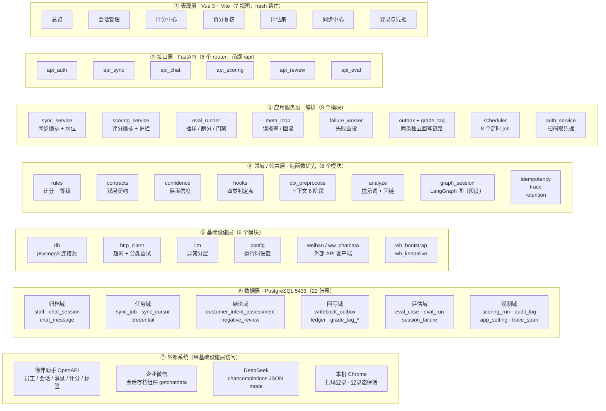
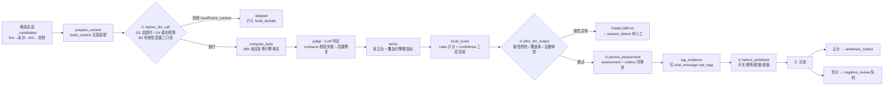
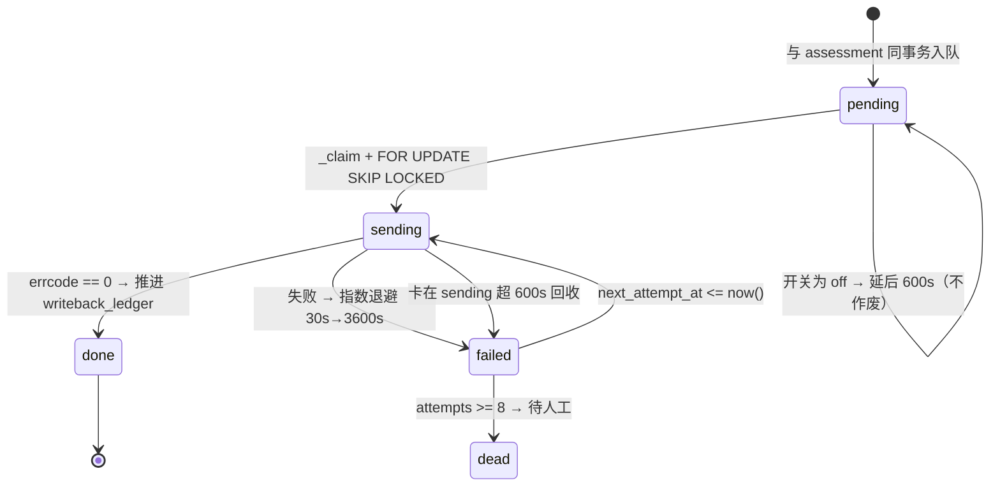
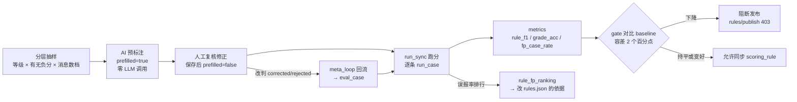

# 客户意向评分系统 —— 架构设计文档 v2（源码实测版）

> **本文件的性质**：完全依据当前源码反向重建，不引用任何既有设计文档的表述。
> 文中每一条结构、参数、状态机都能在代码里指认来源；与旧文档冲突处，以本文件为准。
>
> 生成方式：全量通读 `backend/`（26 个模块）、根目录共享模块（10 个）、
> `frontend/src/`（7 视图 + 3 基础文件）、`backend/schema.sql`、`rules.json`、`tests/`（23 个脚本）。

---

## 1. 系统概览

| 项目 | 实测结论 |
|---|---|
| 业务定位 | 把「企业微信聊天记录」变成「客户意向评分 + 等级 + 跟进建议」，并回写微伴 |
| 架构风格 | 前后端分离 + **模块化单体**（单进程 FastAPI，内嵌后台线程与 APScheduler） |
| 后端 | Python 3.13 · FastAPI · uvicorn · `backend/` 25 个 Python 模块约 8200 行 + `schema.sql` 592 行；其中 `scoring_service.py` 单文件 1784 行 |
| 前端 | Vue 3 · Vite 5 · vue-router（hash 模式）· axios，**无状态管理库** |
| 存储 | PostgreSQL 16（pgvector 镜像）· 22 张表 · 宿主端口 **5433** |
| 大模型 | DeepSeek（OpenAI 兼容），JSON mode；**schema 强约束靠提示词 + 客户端校验** |
| 进程模型 | 1 个 uvicorn 进程 + 若干 `threading.Thread`（同步/评分/评估/登录）+ 8 个定时 job |
| 端口 | 后端 8848 · 前端 dev 5173 · PostgreSQL 5433 |

### 1.1 三条「铁律」（贯穿全部设计）

这三条不是风格偏好，而是**用代码强制**的：

1. **模型只判断，代码算分。** 模型输出「哪条规则命中、证据是哪个编号」；
   `rules.compute_score()` 负责加法与等级映射，`contracts.AssessmentOut` 里
   总分/等级字段**不接受模型回填**。
2. **置信度必须算出来，不能问出来。** `model_confidence` 仅留档，
   决策用的是 `confidence.py` 由证据回链、覆盖率、无效项、与上次一致性合成的
   `session_confidence` 与 `review_reasons`。
3. **证据必须回链到原文。** 模型写的 `#012` 会经 `ctx_preprocess.resolve_evidence()`
   映射成 `message_id`，回链失败即丢弃该项并计入 `invalid_items`。
   `evidence` 字段一律取本地原文行，**不采信模型自述**。

---

## 2. 架构总览

> 渲染好的图片见 `架构图-1-系统分层总览.png`（同源文件：`架构图.html`）。



> **读图说明**：层与层之间用**不可见连线**连接 —— Mermaid 在存在跨子图实线箭头时会
> 忽略子图的 `direction`，导致每层塌成竖排一列（实测 3492×1097 变 1502×10066）。
> 因此本图用「自上而下」表达依赖方向，箭头语义由下面各张流程图承担。

**依赖方向**：表现层 → 接口层 → 服务层 → 领域层 → 基础设施层 → 数据层。
唯一的反向依赖是 `db.py` 为了复用根目录模块而 `sys.path` 回插，
以及 `graph_session` 对 `scoring_service` 的**闭包注入**（避免 `threading.Lock` 进 state）。

---

## 3. 分层职责

### 3.1 表现层（`frontend/src`）

7 个视图，全部通过 `api.js` 中 60+ 个封装函数访问后端；`App.vue` 每 15 秒轮询
`/api/auth/status` 显示凭据健康灯。路由使用 hash 模式，构建产物由后端 `/` 挂载托管。

### 3.2 接口层（`backend/api_*.py`）

| 模块 | 前缀 | 关键端点 |
|---|---|---|
| `api_auth` | `/api/auth` | `status` / `login`（弹浏览器扫码）/ `verify` |
| `api_sync` | `/api/sync` | `start` / `stop` / `status` / `jobs` / `schedule` / `keepalive` |
| `api_chat` | `/api` | `stats` / `staffs` / `sessions` / `messages` / `search` |
| `api_scoring` | `/api/scoring` | `start` / `stop` / `status` / `assessments` / `rules` / `settings` / `grade-tags/*` / `public-class-review` / `retention` |
| `api_review` | `/api/review` | `list` / `detail` / `submit` / `status` / `batch-status` / `audit` |
| `api_eval` | `/api/eval` | `sample` / `save` / `prefill` / `run` / `baseline` / `gate` / `backfill` / `export` |

接口层**不含业务判定**：`/api/scoring/rules/publish` 的门禁拦截委托 `eval_runner.gate_decision`，
`before_writeback` 等判定委托 `hooks`。

### 3.3 应用服务层

| 服务 | 职责 | 关键不变量 |
|---|---|---|
| `SyncService` | 微伴元数据 → 企微解密 → UPSERT | 水位 `sync_cursor` 单调递增；与评分互斥 |
| `ScoringService` | 候选筛选 → 上下文 → LLM → 计分 → 落库 → 分流 | 单会话失败不中断整轮；跨进程互斥 + 僵尸回收 |
| `eval_runner` | 分层抽样 → 逐条跑分 → 指标 → 回归门禁 | 跑分**只算不落业务表**；门禁「无法判定」≠「通过」 |
| `meta_loop` | 误报率排行 + 改判回流评估集 | 只统计人工 `done` 的复核 |
| `failure_worker` | 失败会话重投 | 用 `score_session` 绕过水位，否则永远重投不了 |
| `outbox` / `grade_tag` | 分数回写 / 等级标签回写 | 两条链路**表、开关、水位全独立** |
| `scheduler` | 8 个 job | `guard_can_start` 统一互斥入口 |
| `auth_service` | 扫码抓 cookie + open_sid | 抓取前校验，校验不过不写盘 |

### 3.4 领域 / 公共层

这一层的设计原则是**纯函数优先**：`hooks`、`confidence`、`ctx_preprocess`、`rules`
都不碰数据库（I/O 由调用方查好后作为参数传入），因此可被穷举边界测试。

`ctx_preprocess` 是「消息 → 文本」的唯一实现（6 阶段管道 S1 归型 → S2 降噪 →
S3 窗口 → S4 编号时间 → S5 渲染 → S6 组装），
输出 `text` / `index` / `labels` / `stats` 四件套，供提示词与证据回链共用。

### 3.5 基础设施层

- `db`：`ConnectionPool(min=1, max=8)`，`dict_row`，`autocommit=True`；显式事务用 `tx()`。
- `http_client`：统一超时 30s、只重试 408/429/5xx 与网络故障，业务 `errcode != 0` 立即失败。
- `llm`：`RetryableLLMError` / `FatalLLMError` / `EmptyCompletionError` / `TruncatedCompletionError`
  四类分层，是「重试 vs 转人工」的判据。

---

## 4. 关键运行链路

### 4.1 评分链路（单会话）



**上下文装配（`build_context`）的五段结构**是本系统最有辨识度的设计：

| 段 | 内容 | 是否可裁剪 | 是否可作证据 |
|---|---|---|---|
| ① 客户状态档案 | 上次画像/策略摘要，读回自上次评估 | **永不裁剪** | 否（无 `#编号`） |
| ② 上次评分明细 | 上次命中项与合计 | **永不裁剪** | 否（无 `#编号`） |
| ③ 增量消息 | 水位之后的新消息（软上限 200） | 先砍最早的 | 是 |
| ④ 关键历史 | K2 规则集命中的历史证据（上限 30 条） | 每组收缩到最新 1 条 | 是 |
| ⑤ 兜底窗口 | ③④ 有效条数不足时补齐 | 整段砍 | 是 |

裁剪顺序是刻意的：**③ 是可再生资源，④ 是不可再生资源** ——
砍 ③ 只损失冗余，砍 ④ 会让某个维度彻底没证据。超预算时若砍完仍超，
如实上报 `budget_exceeded`，不退回「只看最近 60 条」。

### 4.2 回写 outbox（修「回写永久丢失」）



两条链路刻意不共享任何表：

| 维度 | 分数回写（`outbox`） | 等级标签（`grade_tag`） |
|---|---|---|
| 微伴语义 | 只能累加、**无覆盖接口** | 有增有删 → 天然覆盖 |
| 写法 | **差值**累加（`writeback_ledger`） | `batch_update`：add 新 + remove 旧 |
| 开关 | `score_writeback_mode` | `grade_tag_mode`（**默认 off**） |
| 幂等键 | 一次评估写一次 | 同一客户只认最新等级（旧任务标 `superseded`） |

**差值累加**是分数链路的硬前提：整值回写会在「累加语义」下让客户分数虚高。
差值是**入队时固化**的，出队重试时不再重算（水位可能已被别的任务推进）。

### 4.3 同步链路

```
凭据体检(wb_keepalive) → 员工列表 → 会话列表(按水位提前止翻页)
  → 逐会话：消息元数据(先落库) → getchatdata 批量解密 → 二次 UPSERT 回填正文
  → 推进 sync_cursor → 刷新 chat_session.msg_count
```

解密是「HTTP 直连企微云」而非浏览器：微伴给的是「锁 + 钥匙」
（`original_id` = 企微 `msgid`，`secret_key` = 加密密钥），
真正开锁的是 `getchatdata`。因此不需要企业私钥、不需要 SDK。

### 4.4 评估集与回归门禁



三条铁律：**只标 rule_id 不标总分**、**跑分只算不落库**、**门禁看方向**。
`prefilled` 样本默认**排除**在指标外 —— 否则就是「AI 批改自己」。

### 4.5 凭据保活

微伴无账号密码入口，登录态是**滑动过期**（每次访问重置为 now+7 天）。
因此 `wb_keepalive` 只做一件事：定期访问一次后台。
刷新流程是「先校验 `jsapi_sign` 再写盘」，校验不过保留原文件并备份到 `ww_bootstrap.bak.json`。

---

## 5. 数据模型

22 张表按域划分：

| 域 | 表 | 说明 |
|---|---|---|
| 归档 | `staff` `chat_session` `chat_message` | 主键约定：`chat_message(staff_id, session_id, message_id)` |
| 任务 | `sync_job` `sync_cursor` `credential` | 水位单调递增；`credential` 单行约束 `CHECK (id = 1)` |
| 规则 | `scoring_rule` | 版本化，`UNIQUE(rule_version, rule_id, score)`，一档一行 |
| 结论 | `customer_intent_assessment` | 每次评估一行 + `is_current` 标记当前有效 + `superseded_by` 连历史 |
| 复核 | `negative_review` | `UNIQUE(assessment_id)` |
| 回写 | `score_writeback` `writeback_outbox` `writeback_ledger` | 流水 / 待办 / 水位，三者分工明确 |
| 标签 | `grade_tag_outbox` `grade_tag_ledger` | 与分数链路完全隔离 |
| 评估 | `eval_case` `eval_run` | `messages_hash` 防样本漂移 |
| 观测 | `scoring_run` `audit_log` `app_setting` `trace_span` `session_failure` | `app_setting` 可覆盖 `.env` |
| 幂等 | `request_guard` | `request_key` 原子占位 |

### 5.1 两个「去重」解决不同层面的问题

- `uq_assessment_run_session (source_run_id, session_id)` → 同一轮同一会话只落一条。
- `is_current` + `superseded_by` → 同一客户在列表里只出现一条，同时保留完整历史。

`repair_current_flags()` 在启动时自愈两种破损（无 current / `superseded_by` 悬空）——
破损来自**外部删除**，插入路径补不了。

---

## 6. 配置与开关

配置三层，优先级由高到低：
**`app_setting` 表（运行时，前端可改） > 系统环境变量 > `.env` 文件 > 代码默认值**。

关键开关（默认值均为「安全侧」）：

| 开关 | 默认 | 含义 |
|---|---|---|
| `score_writeback_mode` | `dry_run` | 分数回写：只记录不真写 |
| `grade_tag_mode` | `off` | 等级标签：完全不动微伴（连待办都不产生） |
| `writeback_delta_mode` | `true` | 差值累加（开 live 前不要关） |
| `use_graph_session` | `false` | 走 LangGraph 图路径，否则走旧串行实现（一键回滚点） |
| `use_outbox` | `true` | 回写与评分解耦 |
| `eval_gate_enabled` | `true` | 改规则前必须过回归门禁 |
| `data_retention_days` | `0` | **不清理**（保留多久是业务决策） |
| `trace_enabled` | `false` | 本地链路追踪（只存结构指纹，绝不落正文） |
| `scoring_deadline_minutes` | `120` | 整轮总超时（0 = 不限） |
| `scoring_max_llm_calls` | `500` | 成本预算（0 = 不限） |

---

## 7. 架构分析与优化建议

### 7.1 值得保留的设计

1. **护栏集中化**：4 个 hook 把散落的 `if` 收敛成统一判定点，且 `REASON_TO_WB_STATUS`
   保证改造前后行为逐字一致（有 9 组对照测试盯着）。
2. **双入口灰度**：`use_graph_session` 让新旧两条评分路径并存，
   用 `test_graph_session_parity.py` 断言 `raw_score/grade` 差异为 0。
3. **三条「默认安全」**：回写默认 dry_run、标签默认 off、保留期默认不清理 ——
   对外部系统的副作用一律需要人显式打开。
4. **可归因**：`rule_version` + `prompt_version` + `schema_version` + `model_name`
   四件套让「分数为什么变了」可回答。
5. **观测内建**：`scoring_run.detail` 里落了上下文分段计数、裁剪明细、
   token 用量、单会话耗时分布（p50/p95/max）、钩子拒绝分布。

### 7.2 结构性风险

| # | 风险 | 影响 |
|---|---|---|
| 1 | **唯一事实源被打破**：DDL 分散在 `schema.sql` + `failure_worker.ensure_columns()` + `idempotency._ensure_table()` | 三处定义可能漂移；无迁移框架 |
| 2 | **进程内互斥不完整**：`scoring.is_running()` 查 DB 跨进程，`sync.is_running()` 只看线程 | 脚本/调度器与后端并发同步时，评分仍可能读到半截会话 |
| 3 | **无鉴权**：`/api/*` 全开放，`actor`/`reviewer` 由前端传字符串 | 审计不可信；写入微伴真实客户的操作无访问控制 |
| 4 | **可复现性缺失**：`requirements.lock.txt` 被 `.gitignore` 忽略 | `requirements.txt` 承诺的「精确版本」实际不存在 |
| 5 | **机器耦合**：Chrome 路径、profile 路径、Python 路径硬编码 | 无法在第二台机器部署 |
| 6 | **数据卫生**：`analyze_result_real.json`（真实客户评估结果）已进版本库 | PII 泄露；仓库根另有 1.4 GiB 本地对象（已删 zip 仍在历史中） |

### 7.3 建议的演进路线

1. **加一层应用鉴权**（哪怕是最简单的静态 Token + 从服务端注入 `actor`），
   并把写外部系统的端点（`grade-tags/align`、`retention/purge`、`rules/publish`）
   收敛到需要显式确认的角色。
2. **收敛 DDL**：把 `ensure_columns()` 与 `_ensure_table()` 的全部语句合并回 `schema.sql`，
   或引入 Alembic，让「schema 只有一个来源」重新成立。
3. **把互斥提升为数据库级**：用 `pg_advisory_lock` 或统一的 `job_lock` 表替代
   进程内的 `_thread` 判断，覆盖同步/评分/评估三类长时间任务。
4. **接上已经写好但没人调用的部分**：`idempotency.reap()` 目前**无任何调用方**，
   `request_guard` 默认永不清理（`data_retention_days=0`）。
5. **补自动化**：引入 `pyproject.toml` + pytest + ruff，把 23 个脚本式测试纳入
   统一 runner 与 CI；前端补 ESLint/Prettier。
6. **把「配置项」变成一等公民**：约 50 个 `app_setting` 键散落在
   `api_scoring._apply_settings` 的白名单里，建议抽成一张
   声明式注册表（键、类型、默认值、适用场景），前端据此自动渲染设置页。

---

## 8. 附录：模块清单

### 8.1 后端（`backend/`）

| 文件 | 行数 | 职责 |
|---|---|---|
| `scoring_service.py` | 1784 | 评分编排、护栏、候选筛选、上下文装配、回写、复核入队 |
| `eval_runner.py` | 610 | 抽样、跑分、指标、门禁、基线 |
| `schema.sql` | 592 | 全部 DDL（22 张表 + 增量列 + 索引） |
| `api_scoring.py` | 589 | 评分中心端点 + 约 50 个设置键读写 + 审计 |
| `grade_tag.py` | 492 | 等级 → 微伴标签独立链路 |
| `backfill.py` | 472 | 历史数据回填 |
| `sync_service.py` | 430 | 同步编排 |
| `scheduler.py` | 405 | 8 个定时 job |
| `confidence.py` | 369 | 三层置信度合成 |
| `api_eval.py` | 364 | 评估集端点 |
| `hooks.py` | 346 | 四类判定点（纯函数） |
| `graph_session.py` | 293 | LangGraph 单会话图 |
| `outbox.py` | 274 | 分数回写 outbox |
| `api_review.py` | 228 | 负分复核端点 |
| `meta_loop.py` | 226 | 误报率 + 回流 |
| `auth_service.py` | 176 | 扫码凭据 |
| `failure_worker.py` | 166 | 失败重投 |
| `api_chat.py` | 160 | 聊天查询 |
| `http_client.py` | 143 | 统一 HTTP 层 |
| `trace.py` | 127 | 链路追踪 |
| `idempotency.py` | 122 | 请求幂等 |
| `retention.py` | 113 | 数据保留 |
| `db.py` | 100 | 连接池与运行时设置 |
| `main.py` | 98 | 应用装配 + SPA 托管 |
| `api_sync.py` | 85 | 同步端点 |
| `api_auth.py` | 29 | 鉴权端点 |

### 8.2 根目录共享模块

`analyze.py`（提示词与回链）· `rules.py`（计分）· `contracts.py`（双层契约）·
`ctx_preprocess.py`（上下文管道）· `llm.py`（LLM 客户端）· `config.py`（配置）·
`rules.json`（15 条规则：8 正 7 负）· `weiban.py`（微伴客户端）·
`ww_chatdata.py`（企微解密）· `wb_bootstrap.py` / `wb_keepalive.py` /
`wb_chat_export.py` / `wb_staff_export.py` / `weiban_chat_fetch.py`（浏览器导出与保活）

### 8.3 评分规则（`rules.json` v1.0）

- 分值域：`[-12, +13]`；等级阈值：S ≥ 6 / A ≥ 4 / B ≥ 2 / C ≥ 0 / D 兜底。
- 加分 8 条（同一 `rule_id` 取最高档，跨维度累加）；扣分 7 条（可叠加）。
- 其中 `negative_no_reply_2d` 的 `engine = "rule"`，**由代码硬算，不允许模型判定**
  （它是 `llm_rule_ids()` 排除在「必须逐条表态」之外的唯一一条）。
