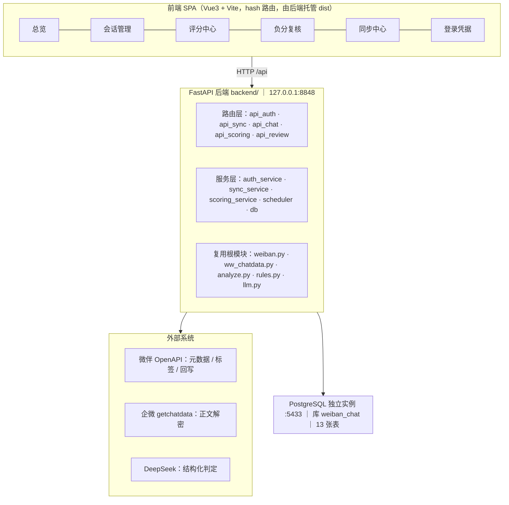
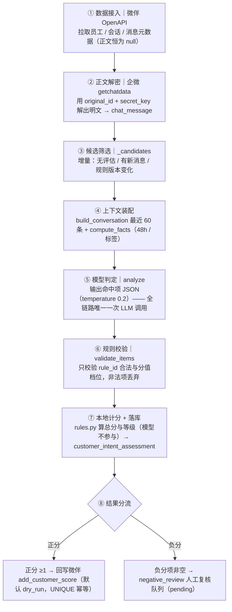
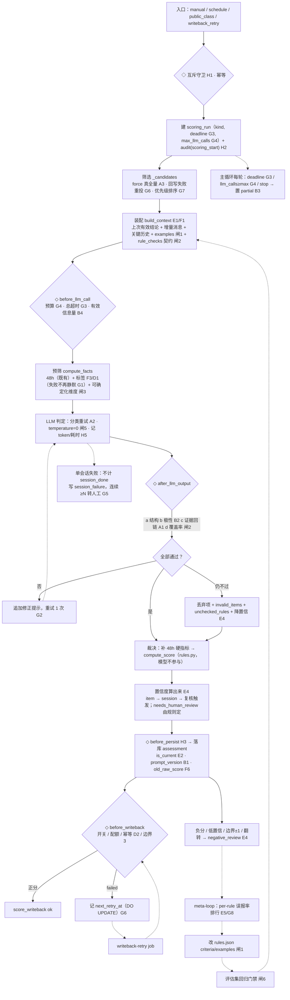
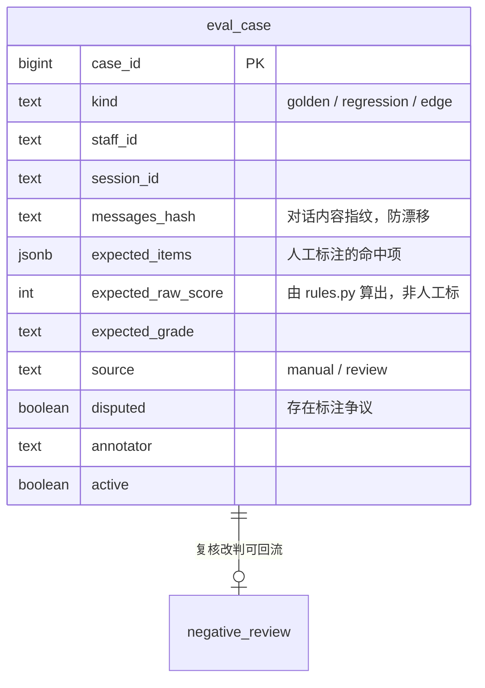

# 客户意向评分系统 · 架构设计说明书

> 工作区：`C:/zero/workbuddy/kechengdemo`  
> 版本：**v1.1（设计稿）**  
> 整理日期：2026-10-14  
> 状态：**仅设计，未改动任何代码**
>
> **v1.1 变更**：新增**第四章　上下文装配层设计（关键历史检索 + 裁剪器）**——  
> 把第二章 2.3「上下文层（当前最弱）」展开为可实现的工程方案（SQL / 算法 / 预算 / 验收），  
> 并给出记忆方案 §4.5 四段装配的**落地版**（拆为三步，前两步零依赖）；  
> 原第四～九章顺延为第五～十章。
>
> 配套文档（交叉引用，本文件不改动它们）：
>
> - `客户意向评分_优化建议.md` —— 问题清单（编号 A/B/C/D/E/F/G/H）
> - `客户意向评分_落地实施方案.md` —— 规则强制 / 评估集 / 置信度 / 安全 / 节奏
> - `客户意向评分_记忆系统设计方案.md` —— 记忆系统 v1.1（M0–M5，决议 M-A~M-D）
> - `客户意向评分_RAG与知识层选型评估.md` —— 为什么不用 RAG / 向量库 / GraphRAG
> - `客户意向识别系统需求文档.md` —— 需求原文（§5 判分规则、§6 输入输出、§9.3 规则表字段）
>
> **一句话结论：架构形态不动（仍是「单 Agent + 确定性编排」），把每一层的「强制力与可见性」补齐。**  
> **上下文装配层是全系统唯一"取什么给模型看"的地方——本章把它从"按位置（最近 60 条）"升级为"按价值（该看的都看得到 + 不超预算）"。**

---

## 目录

- [第一章　现状架构](#第一章现状架构)
- [第二章　目标架构（八层）](#第二章目标架构八层)
- [第三章　目标判定链路](#第三章目标判定链路)
- [第四章　上下文装配层设计（关键历史检索 + 裁剪器）](#第四章上下文装配层设计关键历史检索--裁剪器)
- [第五章　评估集设计](#第五章评估集设计)
- [第六章　置信度设计](#第六章置信度设计)
- [第七章　新增数据表 / 字段 / 配置清单](#第七章新增数据表--字段--配置清单)
- [第八章　落地路线](#第八章落地路线)
- [第九章　明确不做](#第九章明确不做)
- [第十章　待拍板（阻塞项）](#第十章待拍板阻塞项)

---

# 第一章　现状架构

## 1.1 一句话定位

系统是**两段拼起来的**：

| 段           | 做什么                                         |
| ----------- | ------------------------------------------- |
| 前段 · 会话存档系统 | 把微伴 + 企微的聊天记录搬进自建 PostgreSQL                |
| 后段 · 客户意向评分 | 读库里的聊天记录 → 按 `rules.json` 打分 → 回写微伴 / 进人工复核 |

**地基事实（整套系统最不可替代的一环）**：  
微伴 OpenAPI 永远拿不到聊天正文（`content` / `text_content` 恒为 `null`），  
正文必须走企微「会话存档展示组件」的 `getchatdata` 解密链路：

```
微伴 OpenAPI 给 original_id（= 企微 msgid）与 secret_key（= 解密密钥）
        ↓
企微 /wwopen/monoApi/openData/frame/createOpenChatSession 换 sid
        ↓
企微 /chatdata/getchatdata 用 sid + original_id 拿回明文
```

「微伴给锁和钥匙，开锁的是企微」。

## 1.2 分层现状



| 层     | 现状要点                                                                                                                                                       |
| ----- | ---------------------------------------------------------------------------------------------------------------------------------------------------------- |
| 前端    | Vue3 + Vite，hash 路由 6 页；`npm run build` 后由后端 8848 托管 `frontend/dist`（**改前端后必须重启后端才生效**）                                                                    |
| 后端    | FastAPI；路由 5 个模块 / 服务 5 个模块；直接 import 根目录既有模块，不重写                                                                                                          |
| 复用根模块 | `weiban.py`（微伴 OpenAPI）、`ww_chatdata.py`（企微正文解密）、`wb_keepalive.py`（凭据保活）、`analyze.py`（提示词 + LLM 分析）、`rules.py` + `rules.json`（规则引擎）、`llm.py`（DeepSeek 客户端） |
| 存储    | PostgreSQL 独立实例 `:5433`（容器 `weiban-chat-pg`），库 `weiban_chat`，13 张表                                                                                         |
| 调度    | APScheduler 3 个 job：`auto-incremental-sync` / `credential-keepalive` / `auto-scoring`                                                                      |

**13 张表**：`staff` / `chat_session` / `chat_message` / `sync_cursor` / `sync_job` / `credential` /  
`scoring_rule` / `customer_intent_assessment` / `score_writeback` / `negative_review` /  
`scoring_run` / `audit_log` / `app_setting`。

## 1.3 业务主链路（8 步）



对应代码位置：

| 步骤       | 函数                                 | 文件 · 行号                                             |
| -------- | ---------------------------------- | --------------------------------------------------- |
| ③ 候选筛选   | `_candidates`                      | `backend/scoring_service.py` L265–296               |
| ④-a 会话正文 | `build_conversation`               | `backend/scoring_service.py` L137–159               |
| ④-b 事实   | `compute_facts`                    | `backend/scoring_service.py` L91–132                |
| ⑤ 模型判定   | `_llm_analyze` → `analyze.analyze` | `scoring_service.py` L300–309；`analyze.py` L142–180 |
| ⑥ 校验     | `validate_items`                   | `rules.py` L30–55                                   |
| ⑦ 计分     | `compute_score` / `grade_of`       | `rules.py` L58–83                                   |
| ⑦ 落库     | `_score_one`                       | `backend/scoring_service.py` L391–446               |
| ⑧ 回写     | `_writeback`                       | `backend/scoring_service.py` L331–366               |
| ⑧ 复核入队   | `_enqueue_review`                  | `backend/scoring_service.py` L370–387               |
| 主循环      | `_run`                             | `backend/scoring_service.py` L450–501               |

## 1.4 现状判断

**形态是对的，不必改：**

- **单 Agent + 确定性编排**：`_score_one` 是「输入（会话 + 规则表 + 事实）→ 输出（命中项 JSON）」的  
  **单轮无依赖判定**，没有子任务、没有 DAG、没有等待条件。多 Agent 只会让每个 Agent 看到同一份上下文却只看局部规则。
- **模型无工具调用权**（[H4]）：取标签、解密、回写全部由代码显式调用，模型只输出 JSON。  
  即使被提示词注入，最坏也只在评分 JSON 里捣乱，**触达不到任何外部系统**。这是架构级优点。
- **推理与控制分离**：模型只给命中项 + 证据，总分/等级由 `rules.py` 本地算。
- **副作用受控**：回写默认 `dry_run`；`score_writeback UNIQUE(assessment_id)` 幂等。

**问题全在「层内的强制力与可见性」**：

| 现象                                                         | 位置                            | 编号    |
| ---------------------------------------------------------- | ----------------------------- | ----- |
| `except Exception: pass` 静默吞掉取标签失败，分数被静默降级                 | `scoring_service.py` L127–128 | G1    |
| 单会话异常同时 `llm_failed+1` 与 `session_done+1`，完成率永远好看          | `scoring_service.py` L481–483 | G5    |
| 回写失败后水位已推进，`ON CONFLICT DO NOTHING` 让手动重跑也不落新记录 → **永久丢失** | L331–366 + L289–292           | G6    |
| `force` 参数收了但函数体从未引用，「全量重评」不生效                             | L265–296                      | A3    |
| `evidence` 不校验是否出自原文                                       | `analyze.py` L142–180         | A1    |
| 历史评估结论只写不读，每次重评都从零开始                                       | `build_conversation` L137–159 | E1/F1 |
| 定时同步只查同步自己在不在跑，不查评分                                        | `scheduler.py` L56–63         | H1    |
| 评分链路全程不写 `audit_log`                                       | `scoring_service.py` 全链路      | H2    |

---

# 第二章　目标架构（八层）

> 形态不变，补齐每层的护栏与可见性。**橙色＝新增/改造，绿色＝已达标保持。**


## 2.1 入口层

| 项        | 现有                                                  | 目标改动                                                                                                                                                                                                 |
| -------- | --------------------------------------------------- | ---------------------------------------------------------------------------------------------------------------------------------------------------------------------------------------------------- |
| 互斥守卫     | `_job` L56–63 **只查同步自己**；`_scoring_job` L81–90 两边都查 | 抽共享 `guard_can_start(owner)`；`_job` 补 `if scoring.is_running(): return` **[H1]**                                                                                                                     |
| 定时任务     | 3 个 job                                             | 增至 **5 个**：+ `morning-sa-review`（**触发时刻 UI 可配**，扫 S/A 走增量刷新）**[F2]**、+ `writeback-retry`（扫 `failed/pending` 重投）**[G6]**；另加**手动入口** `POST /api/scoring/public-class-review`（公开课不定期，课前/课后两种模式）**[F2]** |
| 手动端点     | `/start /stop /settings /schedule`                  | 关键操作（切 `live`、改 `rules.json`、改参数）写 `request_key` 幂等 + 写 audit **[H2]**                                                                                                                               |
| 触发来源     | `manual` / `schedule`                               | 增加 `public_class` / `writeback_retry` 两类 `triggered_by`                                                                                                                                              |
| ~~角色权限~~ | 无登录体系                                               | **本轮明确不做**（见第九章），`audit_log.actor` 仍记录 `manual`/`schedule`，用于追溯"改了什么"                                                                                                                                |

## 2.2 编排层

| 项    | 现有                                                  | 目标改动                                                                                                     |
| ---- | --------------------------------------------------- | -------------------------------------------------------------------------------------------------------- |
| 主循环  | `_run` L450–501 顺序遍历，停止信号每会话检查一次                    | 每轮检查 `deadline`（总超时）**[G3]** 与 `llm_calls >= max_llm_calls`（成本预算）**[G4]**，超限优雅退出并置 `partial`             |
| 失败口径 | L481–483 同时 `llm_failed+1` 与 `session_done+1`       | 失败不再计入 `session_done`，改 `session_failed+1` 并写 `session_failure` 明细 **[G5]**；连续失败 ≥N 转人工                  |
| 任务状态 | `scoring_run.status`：running/success/stopped/failed | 增加 **`partial`**（超时 / 预算 / 止损触发）**[B3]**                                                                 |
| 候选筛选 | `_candidates` L265–296（`force` 未生效）                 | SQL 加 `force` 分支（真全量）**[A3]**；增量条件补「上次回写 failed 需重投」**[G6]**；排序按优先级（S/A → 新消息 → 未评 → 规则变更）**[G7]**       |
| 审计   | 批量评分全程不写 audit                                      | 启动 / 结束 / 失败三节点写 `scoring_start` / `scoring_done` / `scoring_failed`；`set_settings` 每个变更 key 留痕 **[H2]** |

## 2.3 上下文工程层（当前最弱）

| 项     | 现有                                       | 目标改动                                                                                                                                                                                                                               |
| ----- | ---------------------------------------- | ---------------------------------------------------------------------------------------------------------------------------------------------------------------------------------------------------------------------------------- |
| 会话正文  | `build_conversation(limit=60)`，只取最近 60 条 | 升级为 **`build_context()`**，**五段拼装**（**详见第四章**）：① **客户档案**＝读回上次有效结论（等级/阶段/画像/已通知等级）② **上次评分明细**＝上次命中项与分值（供前后分比较）③ **增量消息**＝自上次 `last_msg_time` 起 ④ **关键历史**＝按 `chat_message.rule_tags` 精确检索的早期证据片段 ⑤ **兜底窗口**＝最近 60 条 **[E1/F1/B4]** |
| 规则可机读 | 每档只有一句 `criteria` 自然语言                   | 每档补 **`examples`**（positive / negative / ambiguous）**[闸1 / F5]**                                                                                                                                                                   |
| 输出契约  | "命中才输出"——**漏判不可检测**                      | 改**逐维度表态** `rule_checks`：15 条规则每条给 hit/no-hit，代码校验覆盖率 **[闸2]**                                                                                                                                                                     |
| 契约版本  | 无                                        | 落 `prompt_version` + `model_name` **[B1]**                                                                                                                                                                                         |
| 采样温度  | `temperature=0.2`，不可复现                   | `temperature=0` **[闸5]**                                                                                                                                                                                                           |
| 画像    | 模型自由文本零校验直接落库                            | 拆结构化带证据字段，自由文本降级为 `summary` **[E3]**                                                                                                                                                                                               |
| 有效信息量 | `len(conv) < 20` 按字符数判                   | 改「消息数 + 客户发言数 + 文本长度」综合阈值 **[B4]**                                                                                                                                                                                                 |

## 2.4 Harness（模型之外的控制）

| 子层           | 现有                                       | 目标改动                                                                                                                                                                                                                                                           |
| ------------ | ---------------------------------------- | -------------------------------------------------------------------------------------------------------------------------------------------------------------------------------------------------------------------------------------------------------------- |
| 上下文组装        | 见 2.3（**工程方案见第四章**）                      | 见第四章                                                                                                                                                                                                                                                           |
| 工具调用         | `_llm_analyze` L300–309 对所有异常无差别重试 3 次   | **异常分类**：可重试＝网络 / 429 / 5xx；不可重试＝401 / 配置 / 4xx（直接转人工，不浪费重试）**[A2]**；JSON 解析失败 → 带修正提示重试 1 次                                                                                                                                                                   |
| **钩子 Hooks** | **无显式机制**，护栏散落各处 `if`                    | 抽 4 个显式钩子，统一返回 `(allow, reason)`：<br />`before_llm_call`（预算 / 超时 / 正文长度）**\[G3\]\[G4\]\[B4]**<br />`after_llm_output`（结构 + 极性 + 证据 + 覆盖）**\[闸4\]\[A1\]\[B2\]\[G2\]\[闸2]**<br />`before_writeback`（开关 / 幂等 / 配额）**\[D2\]\[边界3]**<br />`before_persist` **[H3]** |
| 校验           | `validate_items` L30–55 只校验 rule_id / 分值 | 加**极性校验**（负分规则不得进加项）**[B2]**；加**证据回链** `verify_evidence` **[A1]**；加**覆盖率** `check_coverage` **[闸2]**；任一不过 → **追加修正提示重试 1 次**（Harness 内循环）**[G2]**；`compute_score` L58–75 的静默截断改为断言 / 留痕                                                                        |
| 权限           | 无登录，`actor` 写死                           | **本轮不做**（见第八章）                                                                                                                                                                                                                                                 |
| 可观测          | 见 2.7                                    | 见 2.7                                                                                                                                                                                                                                                          |

## 2.5 工具层

`weiban.py` / `ww_chatdata.py` / `llm.py` / `wb_keepalive.py`：统一 client wrapper  
（超时 / 分类重试 / 结果校验 / 审计 / metrics）**\[A2\]\[H2\]\[H5]**；  
`compute_facts` 取标签失败不再 `except: pass`，改记录 `tool_failure` 并在事实文本标注降级 **[G1]**；  
`add_customer_score` 语义验证（覆盖 vs 累加）**[D2]**；超时保留 `TIMEOUT=30`。


## 2.6 状态存储层

见[第七章](#第七章新增数据表--字段--配置清单)。核心变化：  
评估「只写不读」→ **读回** **[E1]**；无时效 → **`is_current`** **[E2]**；  
无检查点 → **回写重试** **[G6]**；失败无载体 → **`session_failure`** **[G5]**；  
缺版本 → **`prompt_version` / `model_name`** **[B1]**。

## 2.7 可观测层

- `scoring_run` 扩展：token 消耗、单会话耗时分布、工具调用失败率、覆盖率、真实完成率 **\[H5\]\[G5]**
- `audit_log` 补全：评分链路三节点 + 参数变更 **[H2]**
- **meta-loop 复盘回流**：按 `rule_id` 聚合复核改判 → 误报率排行榜 → 回流改 `rules.json` 的 `criteria`/`examples` **[E5/G8]**
- **回归门禁**：改规则前必须跑评估集，指标不降才允许发布 **[闸6]**

## 2.8 安全层（三道边界）

| 边界       | 现状               | 目标                                                                                                                   |
| -------- | ---------------- | -------------------------------------------------------------------------------------------------------------------- |
| 模型与副作用隔离 | ✅ 已做到            | **保持不动**；任何新功能不得给模型开 function calling 通道 **[H4]**                                                                    |
| 副作用开关与配额 | `dry_run` 默认有 ✅  | 加单轮 / 单客户回写配额，超限降级 `dry_run`；上 `live` 前必须先验证 **[边界3 / D2]**                                                          |
| 密钥与出口    | ❌ 无 `.gitignore` | 补 `.gitignore`（`.cache/` `.env` `__pycache__/` `frontend/node_modules/` `frontend/dist/`）+ 检查 git 历史 + 轮换密钥 **[E6]** |

> ❌ **角色权限（管理员 / 复核员 / 只读）本轮不做** —— 见第九章。

## 2.9 Loop 八条护栏对照

| 护栏     | 现状                       | 目标                           |
| ------ | ------------------------ | ---------------------------- |
| 状态机    | ✅ `scoring_run`          | 加 `partial`                  |
| 循环上限   | ✅ `max_sessions`         | 加 `max_llm_calls`            |
| 超时     | ❌ 卡在会话内部（最多 3×120 秒）中断不了 | 加整轮 `deadline`               |
| ~~权限~~ | ❌ 无登录                    | **本轮不做**（保持无登录）              |
| 成本预算   | ❌ 无 token / 调用上限         | 加 `max_llm_calls` + token 上限 |
| 检查点    | ⚠️ 回写失败永久丢失              | 加回写重试通道 + `next_retry_at`    |
| 护栏规则   | ⚠️ 散落各处 `if`             | 收敛为 4 个显式 Hook               |
| 人工审批   | ✅ `negative_review`      | 扩触发条件（低置信 / 边界±1 / 等级翻转）     |

**结论：不追动态分支，只补护栏完整性。** 会话之间无依赖、天然可并行，是该任务形态带来的红利。

---

# 第三章　目标判定链路

> ◇＝新增检查点　↺＝回环



**链路里只有一格是模型**（⑤ LLM 判定），其余全是确定性代码。这是本设计最重要的一条不变量。

---

# 第四章　上下文装配层设计（关键历史检索 + 裁剪器）

> 本章把第二章 2.3「上下文层（当前最弱）」从一行结论展开成**可实现的工程方案**：给出 DDL、SQL、装配算法、  
> 预算与裁剪顺序、验收口径，并给出记忆方案 §4.5「四段装配」的**落地版**（拆为三步，前两步零依赖）。  
> 对应问题编号：**E1 / F1**（只写不读）· **B4**（有效信息量）；需求 **§6.1** 第 3、4、5 条。

## 4.1 现状为什么不够：三个可复现的失效

现状 `build_conversation(limit=60)` ＝ **按位置取数**（最近 60 条）。它有三个失效：

| #      | 失效                 | 触发条件                                             | 后果                                                                                               |
| ------ | ------------------ | ------------------------------------------------ | ------------------------------------------------------------------------------------------------ |
| **X1** | **早期关键事实被挤出窗口**    | `msg_count > 60`（实测 p99=171、max=320，约占 1%~3% 会话） | 「岗位 / 需求 / 预算」这类**最早出现且最重要**的事实不在上下文里 → 直接漏判 `positive_coder_profile`、`positive_clear_work_need` |
| **X2** | **记忆只写不读** [E1/F1] | 每次重评                                             | 读不到"该客户上次是什么状态"→ 无法识别**态度转变**（S→C），也无法阻止同一证据被重复计分                                                |
| **X3** | **"相关历史关键消息"无处可取** | 需求 §6.1 第 5 条                                    | 窗口之外的重要片段（报价、邀约、到课、拒绝）只能靠运气落在 60 条内；且**没有任何检索键**                                                 |

> **实测基线**（`chat_message` 真库）：消息 32,758 条 / 会话 782 个；单会话消息数 p50=**35**、p90=77、p99=171、max=**320**；  
> 单条正文均 169 字；单会话正文均 7,083 字、max 38,194 字（≈4.7k / 25k token）。  
> → **中位数根本没超窗口，问题只在长尾**。因此本章方案必须满足「**短会话零成本、长会话才生效**」（见 4.5.4(4)）。

## 4.2 设计契约（先说不能破坏什么）

| 契约           | 内容                                                                       | 为什么                                                                                                |
| ------------ | ------------------------------------------------------------------------ | -------------------------------------------------------------------------------------------------- |
| **C1 对齐需求**  | 输出必须覆盖 §6.1 五条输入（映射见 4.5.1）                                              | 这是需求硬要求，不是优化项                                                                                      |
| **C2 证据可回链** | 每一行可被模型引用的消息都带 `#编号`，且编号**在整份上下文内唯一**                                    | `analyze._attach_evidence` 靠 `index` 把 `#编号` 映射成 `message_id`；编号一冲突，证据回链（A1）即失效                    |
| **C3 唯一入口**  | 「消息 → 提示词文本」只能经 `build_context()` → `ctx_preprocess.build_llm_context()` | 已有三个同型前科：`force` 未使用(A3) / `scoring_fetch_tags` 默认 False(F3) / `except: pass`(G1)。**入口一多，护栏必然被绕开** |
| **C4 预算上界**  | 单会话 ≤ **12k token**（硬预算，≈18k 中文字符）                                       | 与现状"硬切 60 条"总量同量级，**不增加成本**                                                                        |
| **C5 可观测**   | 每段条数 / 字符数 / 估算 token / 裁剪次数必须落 `scoring_run.detail`                     | 否则"记忆到底有没有被读进去"无法验证                                                                                |
| **不做**       | 不做语义检索（RAG 已否，见选型文档）· 不做摘要压缩（第一期）· **不改分数**（决议 M-C）                      | —                                                                                                  |

## 4.3 两个部件

```
┌─ 部件 A：关键历史消息检索 ────────────────────────────────────┐
│  载体：chat_message.rule_tags TEXT[] + GIN 索引               │
│  查询：按「本次相关规则集」分组取数（每 rule 保底 1，总量 ≤30）  │
│  职责：回答「该看哪几条历史消息」——把位置规则换成价值规则        │
└──────────────────────────────────────────────────────────────┘
┌─ 部件 B：上下文裁剪器 build_context() ───────────────────────┐
│  五段装配 ①②③④⑤ → 去重合并 → 统一编号 → 预算检查 → 按序裁剪 │
│  职责：回答「在预算内把该看的都放进去」                        │
└──────────────────────────────────────────────────────────────┘
```

---

## 4.4 部件 A：关键历史消息检索

### 4.4.1 载体：`chat_message.rule_tags`

**（1）语义定义**

一条消息的 `rule_tags` ＝ **它曾经作为哪些规则的证据被采纳过**（即该消息的 `message_id` 出现在某次评估的  
`positive_items[].evidence_message_ids` / `negative_items[].evidence_message_ids` 里，且该项通过了 `_attach_evidence` 回链）。

> **关键约束：`rule_tags` 是"曾经被采纳"的历史事实，只增不减。**  
> ① 规则改版后旧标签仍有检索价值（那确实是客户说过的关键话）；  
> ② 标签**只决定候选集**，最终是否命中仍由模型基于证据重判 → 不会污染评分；  
> ③ 若支持删除，就要处理"哪次评估撤销了它"，成本远大于收益。

**（2）DDL**

```sql
ALTER TABLE chat_message
  ADD COLUMN IF NOT EXISTS rule_tags TEXT[] NOT NULL DEFAULT '{}';

-- 关键历史检索是「数组包含」语义 → GIN 是最合适的索引
CREATE INDEX IF NOT EXISTS idx_msg_rule_tags
  ON chat_message USING gin (rule_tags);
```

**（3）写入时机与幂等**

在 `_score_one` 落库 `customer_intent_assessment` 之后（建议挂在 `before_persist` 钩子 [H3] 之后、回写之前）：

```sql
-- 把本轮采纳的 (rule_id, message_id) 对，「只增不减」地合并进 rule_tags
UPDATE chat_message m
   SET rule_tags = (
         SELECT ARRAY(SELECT DISTINCT unnest(m.rule_tags || %(new_tags)s::text[]) ORDER BY 1)
       )
 WHERE m.staff_id = %(staff_id)s
   AND m.session_id = %(session_id)s
   AND m.message_id = ANY(%(message_ids)s);
```

- `new_tags` ＝ 该消息本轮对应的 `rule_id` 列表（同一条消息可同时作为多条规则的证据）
- **幂等**由 `ARRAY(SELECT DISTINCT unnest(...))` 保证：重复执行结果不变
- **失败不阻断评分**：标签写入失败只记 `tool_failure`，评分与回写照常——标签是"下一轮的检索键"，不是本轮结论

**（4）为什么是列而不是新表 `message_rule_tag`**

| 方案                                                           | 优点                                                  | 缺点                             |
| ------------------------------------------------------------ | --------------------------------------------------- | ------------------------------ |
| `chat_message.rule_tags TEXT[]` + GIN                        | 零 join；查询是"整行 + 包含判断"，正是 GIN 强项；与 `message_id` 天然同行 | 无法直接记录"哪次评估打的"                 |
| 新表 `message_rule_tag(message_id, rule_id, assessment_id, …)` | 可追溯来源                                               | 每次检索要 join + 去重；3 万条消息量级下收益不明显 |

→ **选列**。来源追溯由 `customer_intent_assessment.positive_items/negative_items`（已存 `evidence_message_ids`）承载，无需在标签上再记一遍。

### 4.4.2 查询：「本次相关规则集」怎么定

| 候选     | 内容                                             | 判断                                   |
| ------ | ---------------------------------------------- | ------------------------------------ |
| K1     | 全部非 `engine=rule` 规则（14 条）                     | ❌ 太宽：每个维度都拉 3 条会把配额吃光，而大部分维度该客户从未表现过 |
| **K2** | **上次评估命中的 `rule_id`** ∪ **本会话 `rule_tags` 全集** | ✅ 正是"该客户历史上表现过信号的维度"                 |
| K3     | 让模型先选维度再检索                                     | ❌ 要多一次 LLM 调用，且引入不确定性                |

→ **定 K2**（当前规则表 15 条，天然不超上限）。

### 4.4.3 两阶段取数（避免"高频规则吃光配额"）

朴素做法 `ORDER BY msg_time DESC LIMIT 30` 会让**消息最多的那个规则**占满 30 条，其余维度一条都进不来。故分两阶段：  
**阶段 1（保底）**&#x6BCF;个相关 `rule_id` 取**最近 1 条**（≤15 条）→ **阶段 2（补足）**&#x5269;余额度按 `msg_time DESC` 补到 30 条。

```sql
WITH rel AS (SELECT unnest(%(rule_ids)s::text[]) AS rule_id),
     hit AS (
       SELECT m.staff_id, m.session_id, m.message_id, m.msg_time, t.rule_id
         FROM chat_message m
         CROSS JOIN LATERAL unnest(m.rule_tags) AS t(rule_id)
        WHERE m.staff_id = %(staff_id)s
          AND m.session_id = %(session_id)s
          AND m.rule_tags && %(rule_ids)s::text[]
     ),
     first_per_rule AS (                       -- 阶段 1：每 rule 最近 1 条
       SELECT DISTINCT ON (rule_id) * FROM hit
        ORDER BY rule_id, msg_time DESC, message_id DESC
     ),
     rest AS (                                 -- 阶段 2：其余按时间倒序
       SELECT h.* FROM hit h
        WHERE NOT EXISTS (SELECT 1 FROM first_per_rule f
                           WHERE f.message_id = h.message_id AND f.rule_id = h.rule_id)
        ORDER BY h.msg_time DESC, h.message_id DESC
     ),
     merged AS (
       SELECT * FROM first_per_rule
       UNION ALL
       SELECT * FROM (SELECT * FROM rest LIMIT GREATEST(%(max_total)s - %(n_rules)s, 0)) r
     ),
     dedup AS (                                -- 同一消息命中多规则 → 合并成一行
       SELECT message_id, msg_time, array_agg(DISTINCT rule_id) AS tags
         FROM merged GROUP BY message_id, msg_time
     )
SELECT message_id, msg_time, tags FROM dedup
 ORDER BY msg_time ASC, message_id ASC
 LIMIT %(max_total)s;
```

- `max_total` = **30**（`ctx_key_history_max`）· 每 rule 保底 1 条 · `n_rules` = 相关规则数
- 输出**按时间升序**，便于与 ③ 段合并后统一编号
- 实际命中数通常 **9~18 条**（单会话一般只表现 3~6 个维度），30 是上限而非常态

### 4.4.4 冷启动：`rule_tags` 全空怎么办

首次评分（或历史数据未打标签）时 ④ 段为空。此时：

- ③ 段的起点 `watermark` 为空 → **增量 = 全量**，与现状等价 → **短会话（≤200 条）不受影响**
- 只有"**首次评分且消息数 > 200**"才会丢早期事实。给一条等价补丁：

> **④′ 早期锚点**：当 ④ 命中数为 0 时，取该会话**最早的 10 条**可读消息（`ctx_cold_start_early=10`）。  
> 理由是"岗位 / 需求 / 预算"这类最重要的事实几乎总在会话开头。

④′ 与 ④ **互斥**（有 ④ 就不启用），并计入同一 30 条配额。

---

## 4.5 部件 B：上下文裁剪器 `build_context()`

### 4.5.1 五段定义与需求 §6.1 的映射

| 段     | 名称     | 数据来源                                      | 依赖        | 上限                  |
| ----- | ------ | ----------------------------------------- | --------- | ------------------- |
| **①** | 客户档案   | `customer_memory`（一客户一行）                  | 记忆方案 M0   | ≈400 token，**不裁剪**  |
| **②** | 上次评分明细 | `customer_intent_assessment` 最新 1 条       | **已有表**   | ≈300 token，**不裁剪**  |
| **③** | 增量消息   | `chat_message WHERE msg_time > watermark` | 已有        | **200 条软上限**        |
| **④** | 关键历史消息 | `chat_message.rule_tags`（部件 A）            | **本章新增列** | **30 条**（每 rule ≤3） |
| **⑤** | 兜底窗口   | `chat_message` 最近 60 条（现状）                | 已有        | 60 条                |

**需求 §6.1 逐条对应：**

| 需求 §6.1 原文要求                  | 落在哪段        | 现状                  |
| ----------------------------- | ----------- | ------------------- |
| 本次聊天记录                        | ③ + ⑤       | ✅ 已有（＝硬切 60）        |
| **上一次有效评分、等级、画像总结、已通知等级**     | **① + ②**   | ❌ **完全未实现**         |
| **自上次分析后的新增消息**               | **③**       | ❌ 未实现（现在是"最近 60 条"） |
| **相关历史关键消息（需求、报价、邀约、到课、拒绝等）** | **④**       | ❌ 未实现               |
| 不得无限量发送全部历史聊天记录               | 预算 + 裁剪（C4） | ⚠️ 靠 `window=60` 硬切 |

> **降级链（保证渐进可落地）**：`customer_memory` 表不存在时，① 用 `customer_intent_assessment` 最新一条的  
> `profile_summary` / `grade` / `raw_score` 拼出"准档案"，② 同源取 `positive_items` / `negative_items`。  
> → **① ② 段不依赖记忆方案 M0 也能先上。**


### 4.5.2 装配算法

```
def build_context(staff_id, session_id, *, rel_key, session_meta) -> dict:
    # ── 取数 ──────────────────────────────────────────────
    mem   = load_memory(rel_key)                    # ①（无表/无记录 → None）
    last  = latest_assessment(rel_key)              # ②（mem 为空时同时作为 ① 的降级源）
    wm    = mem.last_msg_time if mem else (last.last_msg_time if last else None)
    delta = query_messages(msg_time > wm) if wm else query_messages(all)   # ③
    rel_rules = union(keys(last.items), distinct(session.rule_tags))       # 4.4.2 K2
    key   = query_key_history(rel_rules)                                   # ④
    if not key: key = query_early_anchors(limit=ctx_cold_start_early)      # ④′

    # ── 合并去重（③④ 可能重叠）────────────────────────────
    rows = dedup_by_message_id(key + delta)
    rows.sort(key=lambda r: (r.msg_time, r.message_id))                    # tie-breaker 必须有

    # ── 渲染：唯一入口 ────────────────────────────────────
    body = ctx_preprocess.build_llm_context(rows, opts=_ctx_options())
    if body.stats.kept < min_kept:                                         # B4 口径
        rows = dedup_by_message_id(rows + query_recent(60))                # ⑤ 兜底
        body = ctx_preprocess.build_llm_context(rows, opts=_ctx_options())

    # ── 组装分段文本 ──────────────────────────────────────
    seg1 = render_profile(mem, last)      # 记忆块：不带 #编号，用 [M1]/[M2] 段标
    seg2 = render_last_items(last)
    text = join_sections(seg1, seg2, body.text)

    # ── 预算与裁剪（裁剪器）──────────────────────────────
    budget = estimate_tokens(text)
    text, trim = enforce_budget(text, budget)

    return {**body, "text": text,
            "segments": {"profile": seg1, "last_items": seg2, "body_lines": len(body.lines)},
            "budget": {"tokens": budget, "trim": trim}}
```

**排序的确定性**：`key = (msg_time, message_id)`——同一秒的消息用 `message_id` 兜底，  
否则同一会话两次调用可能给出不同顺序（V3 验收要求可复现）。

### 4.5.3 分段文本与编号规则（C2 的关键细节）

最终 `text` 的实际形态：

```
【当前日期】2026-10-14
【客户状态档案】（记忆读回，截至上次评估：2026-10-10）        ← ①
 等级=B（-1 分）｜阶段=已邀课｜岗位=Java后端｜需求=2个月内落地AI客服
 顾虑=价格｜预算=未提及｜时间节点=下季度｜竞品=未提及｜已通知等级=B
 上次画像摘要：……
 上次销售策略：……

【上次评分明细】                                            ← ②
 上次加分项：positive_coder_profile(+2)、positive_ask_course(+2)，合计 +4
 上次扣分项：negative_price_haggling(-1)，合计 -1

【关键历史消息】（该客户历史上表现过信号的证据，按时间升序）    ← ④
 #001 [09-12 10:04｜32天前] 客户: 我是做 Java 后端的…

【近期消息】（自上次评估后新增）                              ← ③
 #012 [10-08 09:12｜6天前] 客户: ……

【最近消息（兜底）】                                          ← ⑤（仅兜底时出现）
 #071 …
```

**编号规则（必须严格，否则 C2 失效）：**

1. ③④⑤ 合并成**一个有序行列表**后，**只调用一次** `ctx_preprocess.annotate()` → 编号 `#001..#NNN` 在全文唯一
2. ①② 是**记忆块，不是消息行**，**不参与 `#编号`**；段内用 `[M1]` / `[M2]` 段标区分
3. `index`（编号 → `message_id`）**只包含消息行**。若模型对某项给出 `evidence_ids:["[M1]"]`，`resolve_evidence` 解析不到 → 该项**被丢弃并进 `invalid_items`**
4. **这条规则就是决议 M-C 落到代码里的样子**：记忆可以影响模型的**理解**（"上次是 S，这次客户说自学 → 态度转变"），  
   但**不能成为任何加减分的证据**——分数 100% 由本次消息证据经 `rules.py` 得出

### 4.5.4 预算与裁剪器（本部件最核心的一节）

**（1）token 估算（零依赖）**：`tokens ≈ len(text) / 1.5`（中文保守系数）。**宁可高估，不可低估**，且不引入 tokenizer 依赖。

**（2）预算分配**

| 段        | 预算                           | 裁剪优先级          |
| -------- | ---------------------------- | -------------- |
| ① 客户档案   | ≈400 token                   | **永不裁剪**（断言保护） |
| ② 上次评分明细 | ≈300 token                   | **永不裁剪**（断言保护） |
| ③ 增量消息   | ≈6,000 token（≈200 条 × 169 字） | 4（先砍最早的）       |
| ④ 关键历史   | ≈3,500 token（≈30 条）          | 2–3            |
| ⑤ 兜底     | ≈1,800 token（≈60 条）          | **1（第一个被砍）**   |
| **合计**   | **≈12,000 token（硬预算）**       | —              |

**（3）裁剪顺序（固定且可测）**

```
超预算时按下列顺序执行，每步后重新估算，达标即停：
  1. 整段砍 ⑤（兜底窗口）
  2. ④ 中「每组 > 1 条」的规则组收缩为「每组 1 条」
  3. ④ 中按 rule 权重升序整组砍（保留高权重维度：需求/岗位 > 地域/竞品）
  4. ③ 从【最早】开始按批砍（每批 20 条）
  5. 仍超预算 → 置 budget_exceeded=true 并写告警，【照原样发送，不砍 ①②】
```

- **第 5 条是刻意的**：①② 是需求 §6.1 的硬要求，也是"记忆"相对"聊天记录"的全部价值。  
  宁可单会话略超预算，也**不允许退回"只看最近 60 条"**。
- **砍 ③ 从最早开始**而不是从最新——"最新"是本次判断最相关的（新鲜度因子），而"早期"已由 ①②④ 承担。
- 每次裁剪累计进 `stats.trim`：`{"d5": n, "shrunk4": n, "dropped4_rules": [...], "dropped3": n}`

**（4）短会话零成本（重要）**

`msg_count ≤ 60` 的会话（**占多数，p50=35**）：③ 全量 = ⑤ 全量，④ 命中少，①② 各固定 ≈700 token。  
→ 结果与现状几乎一致，**只是多出 ①② 两段记忆块**（这正是 E1/F1 要修的）。  
**不存在"给小会话加开销"的问题**——这满足了 4.1 提出的约束。

### 4.5.5 与 `ctx_preprocess` 的分工（避免第二份实现）

| 谁                     | 负责                                |
| --------------------- | --------------------------------- |
| `ctx_preprocess`（纯函数） | **单条**消息的归型 / 降噪 / 渲染 / 编号 / 证据回链 |
| `build_context`（取数）   | **选哪些消息**：五段取数 + 合并去重 + 预算 + 裁剪   |

- `build_context` 只把选好的 rows 交给 `build_llm_context`，**不自己拼文本**
- ⚠️ **⑤ 段不得绕开 `ctx_preprocess`** —— 现状陷阱：为图省事直接取最近 60 条原始行拼接
- `build_conversation(limit)` 保留为**薄壳**（`return build_context(...)["text"]`），供 CLI / 老调用方使用；  
  **评分链路不得再调用它**（V1 断言）

### 4.5.6 提示词侧的必要改动

`SYSTEM_PROMPT` 需增加一段说明（否则模型会把 ①② 当成"本次证据"）：

> 上下文分三段：**【客户状态档案】**&#x4E0E;**【上次评分明细】**&#x662F;**上一次评估的结论**，用于理解客户状态变化；  
> **只有带 `#编号` 的消息行才是本次判断的证据**。若你认为客户态度发生了变化（例如上次等级 S，本次客户说"自己学"），  
> 请在 `customer_profile_summary` 中说明该变化，但**不要**把上次的加减分项重复计入本次命中项。

---

## 4.6 可观测

| 指标                                                                                        | 落在哪                                  | 用途                       |
| ----------------------------------------------------------------------------------------- | ------------------------------------ | ------------------------ |
| `ctx_seg_profile` / `ctx_seg_last` / `ctx_seg_delta` / `ctx_seg_key` / `ctx_seg_fallback` | `scoring_run.detail`                 | 每段实际条数                   |
| `ctx_tokens` / `ctx_tokens_max` / `ctx_budget_exceeded`                                   | 同上                                   | 预算控制                     |
| `ctx_trim`                                                                                | 同上                                   | 裁剪了哪些、多少                 |
| `ctx_key_rules`                                                                           | 同上                                   | ④ 段命中了哪些维度（诊断"关键历史是否可用"） |
| `ctx_segments JSONB`                                                                      | **`customer_intent_assessment` 新增列** | 单次结论"看了什么"的现场（可复现）       |

---

## 4.7 验收口径

| #      | 断言           | 通过标准                                                                                      |
| ------ | ------------ | ----------------------------------------------------------------------------------------- |
| **V1** | **调用点唯一性**   | `grep -rn "build_conversation" backend/ analyze.py` 仅剩定义与 CLI；评分链路 100% 走 `build_context` |
| **V2** | **记忆真的被读进去** | 对 `msg_count > 60` 的会话，`ctx_seg_profile > 0`（① 段非空）——**"工具提供了能力，行为是否真的使用"的断言**            |
| **V3** | **确定性**      | 同一会话连跑两次，**去掉时间标签后**的 `lines` 序列逐项相同                                                      |
| **V4** | **预算**       | p99 长会话 `ctx_tokens ≤ 12k`；超限时 `ctx_trim` 非空且 `ctx_budget_exceeded=true`                  |
| **V5** | **证据回链不被破坏** | `index` 只含消息行编号；构造 `evidence_ids:["[M1]"]` 的项被丢弃并进 `invalid_items`                        |
| **V6** | **④ 段有效性**   | 对已打过标签的会话，`ctx_key_rules` 非空，且 ④ 段条数落在 3~30                                               |

---

## 4.8 落地拆解（三步，每步独立可验收）

> 关键：**不依赖新表就能先做前两步**——本章不必等记忆方案的 M0。

| 步       | 内容                                                                           | 依赖            | 验收                      |
| ------- | ---------------------------------------------------------------------------- | ------------- | ----------------------- |
| **C-A** | `rule_tags` 列 + GIN + 标签写入 + **④ 段取数**（含 ④′ 冷启动）+ 合并去重 + 统一编号                | **无（纯增量）**    | V1 · V3 · V6；长会话的 ④ 段非空 |
| **C-B** | **③ 增量段**（水位取 `customer_intent_assessment.last_msg_time`，**不需要新表**）+ ⑤ 条件化   | C-A           | V3 · V4                 |
| **C-C** | **①② 记忆段**（`customer_memory` → 记忆方案 M0；表不存在时降级读最新 assessment）+ 预算裁剪器 + 提示词说明 | C-A · 记忆方案 M0 | V2 · V4 · V5            |

**C-A 是把"关键历史检索"单独跑通的一步**——只加一列、只改一个函数，跑一次就能看到  
"④ 段到底捞回了哪几条被窗口挤掉的消息"，**是一次成本极低的收益验证**（契合"先验证读回收益"的节奏）。

---

## 4.9 本章明确不做

| 不做                        | 理由                                                             |
| ------------------------- | -------------------------------------------------------------- |
| 语义检索 / embedding 重排 / RAG | 见 `客户意向评分_RAG与知识层选型评估.md`（取数是主键，不是相似度）                         |
| 摘要压缩 / 自动合并               | 反直觉发现：压缩速度 > 组织速度时会丢信息（LongMemEval 裸模型 57.6% > Mem0 OSS 32.4%） |
| token 级精确计数（引入 tokenizer） | 估算系数 1.5 已足够保守，不值一个依赖                                          |
| 让记忆参与计分                   | 决议 M-C：记忆进提示词，进不了 `compute_score`                              |
| 对 ③ 的"首尾抽样"等复杂策略          | 只做 ④′ 早期锚点这一条等价补丁（4.4.4）                                       |

---

# 第五章　评估集设计

> 现状：**全库没有任何 `test*` / `eval*` 文件**，复核侧只有一个「一致率」计数。  
> 本轮决策：**愿意标注金标准（30–50 条）**，故纳入设计。

## 4.1 三层评估集

| 层               | 规模       | 来源       | 用途                                |
| --------------- | -------- | -------- | --------------------------------- |
| 金标准（golden）     | 30–50 条  | 人工标注     | 回答"判得准不准"；每次改规则 / 改提示词必跑          |
| 回归集（regression） | 50–200 条 | 历史已评会话快照 | 回答"这次改动有没有把原来对的改坏"                |
| 边界集（edge）       | 20–30 条  | 人工挑选     | 48h 边界、到课/未到课、比价 vs 主动问课、拒绝 vs 犹豫 |

**标注口径（关键）**：标&#x6CE8;**「命中了哪些 rule_id」**，**不标总分**——  
总分由 `rules.py` 算，标注总分等于让人去实现一遍规则引擎。

## 4.2 存储



- 表承载便于前端标注页；同时支持 `eval/*.jsonl` 文件导出（一行一例）。
- `negative_review` 加 `eval_case_id`，把人工复核改判**自动回流**成评估样本 **[E5]**。

## 4.3 标注流程

1. 选样：从 `chat_session` 中按「等级 × 是否有负分 × 消息数分档」分层抽样，保证覆盖 S/A/B/C/D。
2. 标注：复核员在新增的「评估集」页逐条勾选命中项 + 填简短理由；**不写分数**。
3. 争议：两人标注不一致 → 标 `disputed=true`，由销售负责人仲裁，仲裁结果作为金标准。
4. 冻结：金标准一经冻结，**除仲裁外不得修改**。

## 4.4 回归门禁

```
改 rules.json / 改 SYSTEM_PROMPT
        ↓
跑评估集（金标准 + 回归集）
        ↓
对比基线指标（命中项 F1 / 等级一致率 / 误报率）
        ↓
指标不降 → 允许发布；任一指标下降 → 阻断，回滚
```

配置开关 `eval_gate_enabled`（默认 true）、基线文件 `eval/baseline.json`。

---

# 第六章　置信度设计

## 5.1 铁律

**置信度必须「算出来」，不能「问出来」。**

现状 `analyze.py` L178–179 直接把模型自报的 `confidence` 与 `needs_human_review` 落库并展示  
——等于**让可能出错的组件自己申报可信度**。必须收回。

## 5.2 三层合成

| 层级                           | 怎么算                                                                     |
| ---------------------------- | ----------------------------------------------------------------------- |
| **命中项级** `item_confidence`   | `engine=rule` 的规则恒为 `1.0`；语义项按**证据回链结果**分档（逐字命中 1.0 / 模糊命中 0.7 / 无证据 0） |
| **会话级** `session_confidence` | 命中项置信均值 × 维度覆盖率 − 无效项比例惩罚 + **与上次评估的一致性**加成                             |
| **复核触发**                     | 由**规则**决定（不再听模型）：有负分项 ｜ 低置信 ｜ 等级边界 ±1 ｜ 高权重 +2 档但证据弱 ｜ 与上次等级翻转          |

## 5.3 命名约定

`confidence` → **`model_confidence`**（模型自报值，仅留档观测，**不参与任何决策**）；  
新增 `session_confidence`（系统算出，参与复核触发）；  
新增 `verification_status`（`na` / `verified` / `rejected`，人工验证状态）。  
三者分离，**避免复核员误以为"模型说 0.9"就等于"验证过了"**。

---

# 第七章　新增数据表 / 字段 / 配置清单

## 6.1 新增表

| 表                        | 关键字段                                                                                                | 用途                        | 编号      |
| ------------------------ | --------------------------------------------------------------------------------------------------- | ------------------------- | ------- |
| `session_failure`        | `id, run_id, relationship_key, staff_id, session_id, stage, error_type, error, attempt, created_at` | 会话级失败明细，支撑"连续失败转人工"与真实完成率 | G5      |
| `eval_case`              | 见 5.2                                                                                               | 三层评估集                     | E5 / 闸6 |
| `rule_metric_daily`（或视图） | `day, rule_id, decided_n, overridden_n, false_positive_rate`                                        | meta-loop 误报率排行缓存         | E5 / G8 |

## 6.2 扩展字段

| 表                            | 新增字段                                                                                                             | 用途                     | 编号             |
| ---------------------------- | ---------------------------------------------------------------------------------------------------------------- | ---------------------- | -------------- |
| `customer_intent_assessment` | `is_current BOOL` / `superseded_by BIGINT`                                                                       | 当前有效标记，列表去重            | E2             |
| 〃                            | `model_confidence REAL`（原 `confidence` 改名）、`session_confidence REAL`、`verification_status TEXT`                  | 置信度"算出来" + 与人工验证分离     | E4             |
| 〃                            | `prompt_version TEXT`、`model_name TEXT`                                                                          | 结果变更可归因                | B1             |
| 〃                            | `rule_checks JSONB`、`unchecked_rules INT`                                                                        | 逐维度表态与漏检留痕             | 闸2             |
| 〃                            | `old_raw_score INT`、`last_notified_grade TEXT`                                                                   | 上次有效分数 / 通知等级          | F6             |
| 〃                            | 各 item 内 `evidence_verified INT`                                                                                 | 证据回链结果                 | A1             |
| `scoring_run`                | `deadline TIMESTAMPTZ`、`max_llm_calls INT`、`session_failed INT`、`llm_tokens_in/out BIGINT`、`unchecked_total INT` | 超时 / 预算 / 口径 / 成本 / 覆盖 | G3/G4/G5/H5/闸2 |
| `score_writeback`            | `next_retry_at TIMESTAMPTZ`、`last_attempt_at TIMESTAMPTZ`、`exhausted BOOL`；`ON CONFLICT DO UPDATE`（原 DO NOTHING） | 回写重试通道（修永久丢失）          | G6             |
| `scoring_rule`               | `examples JSONB`、`conflict_priority INT`                                                                         | 规则可机读化（需求 §9.3 本就要求）   | F5 / 闸1        |
| `negative_review`            | `eval_case_id BIGINT`                                                                                            | 改判回流评估集                | E5             |

> `audit_log` / `app_setting` **复用，不新增**；[H2] 只扩写入点。

## 6.3 新增运行时设置（`app_setting` 优先，`.env` 兜底）


| Key                                                           | 默认                                | 用途                                                    | 编号       |
| ------------------------------------------------------------- | --------------------------------- | ----------------------------------------------------- | -------- |
| `scoring_fetch_tags`                                          | **true**（现 false）                 | 到课 / 完课标签可达                                           | F3 / D1  |
| `scoring_deadline_minutes`                                    | 120                               | 整轮总超时                                                 | G3       |
| `scoring_max_llm_calls`                                       | 500                               | 成本预算                                                  | G4       |
| `scoring_temperature`                                         | 0                                 | 降低方差                                                  | 闸5       |
| `scoring_require_coverage`                                    | true                              | 强制逐维度表态                                               | 闸2       |
| `scoring_retry_on_validation_fail`                            | true                              | 校验失败修正重试 1 次                                          | G2       |
| `scoring_llm_timeout_sec` / `scoring_llm_max_retries`         | 120 / 3                           | 分类重试参数                                                | A2       |
| `scoring_min_effective_chars` / `scoring_min_customer_msgs`   | 待定                                | 有效信息量阈值                                               | B4       |
| `scoring_session_fail_threshold`                              | 3                                 | 连续失败转人工                                               | G5       |
| `writeback_max_attempts` / `writeback_retry_interval_minutes` | 5 / 30                            | 回写重投                                                  | G6       |
| `writeback_mode_ledger`                                       | —                                 | **差值累加回写**（客户级回写水位）；「当前等级」改用微伴标签                      | **D2-1** |
| `writeback_quota_per_run`                                     | 待定                                | 单轮回写配额                                                | 边界3      |
| `writeback_quota_per_customer_per_day`                        | 3                                 | 单客户单日配额                                               | 边界3      |
| `scoring_morning_cron`                                        | **UI 可配**（默认早会前）                  | 早会前 S/A 复核的触发时刻（**不写死在代码**，由 `app_setting` + 前端输入框控制） | F2 / D3  |
| `public_class_grade_scope`                                    | S/A                               | 公开课复核的等级范围                                            | F2       |
| `scoring_priority_order`                                      | grade→recency→unrated→rule_change | 优先级排序                                                 | G7       |
| `eval_gate_enabled` / `eval_baseline_path`                    | true / `eval/baseline.json`       | 回归门禁                                                  | 闸6       |
| `data_retention_days`                                         | 待定                                | 数据保留                                                  | 边界4      |
| ~~`auth_roles`~~                                              | —                                 | **本轮不做**                                              | —        |

---

# 第八章　落地路线

| 组                           | 内容                                                                                                                       | 依赖                                          |
| --------------------------- | ------------------------------------------------------------------------------------------------------------------------ | ------------------------------------------- |
| **G0 立即止血**（4 路并行，零外部依赖）    | `E6`（.gitignore + 轮换）· `A3`（force bug）· `H1`（互斥）· `A1`（证据回链）· `A2`（分类重试）                                                 | 无                                           |
| **G1 让规则可信**                | 闸2 逐维度表态 · 闸4/B2 极性 · 闸5 temperature=0 · B1 prompt_version · 闸1/F5 examples · G2 校验重来 · G1 取标签不静默 · F3/D1 fetch_tags 默认开 | 依赖 G0（尤其 A1）                                |
| **G2 让系统可信（记忆）**            | E1/F1 上下文分层读回 · E4 置信度算出来 · E2 is_current · E3 画像结构化 · E5/G8 meta-loop · H5/G5 指标口径                                      | E4 依赖 A1 + 闸2 + E1                          |
| **G3 Loop 护栏完整性**（可与 G2 并行） | G3 超时 · G4 预算 · G5 失败明细 · G6 回写重试 · G7 优先级 · B3 partial · H2 audit · H3 钩子抽象                                             | H3 建议在 G1 时先抽骨架                             |
| **G4 评估集与上线**               | 评估集标注（30–50 条）· 回归门禁 · 副作用配额 · `F2` 早会复核定时 + 公开课手动入口 · **`D2-1` 差值累加回写 + 等级改用标签** · 灰度 live                              | `D2`/`D3` **已定**，无业务阻塞；**`D2-1` 须先于开 live** |

**每阶段的验收锚点**

| 组  | 验收                                                             |
| -- | -------------------------------------------------------------- |
| G0 | git 不再能提交 `.cache/`；改动前后跑同一批会话，`positive_items` 可复现            |
| G1 | `unchecked_rules` 趋近 0；被丢弃证据项占比 < 15%                          |
| G2 | 同一 `msg_count > 60` 的会话连跑两次 `force`，结果一致；评分中心列表每个客户只显示一条"当前有效" |
| G3 | 人为制造超时 / 超预算，任务以 `partial` 结束且失败明细可查                           |
| G4 | 金标准集上命中项 F1 与等级一致率记录在案；改规则必须先过门禁                               |

**如果只做三件**：`E6` 补 `.gitignore`（五分钟）→ `A1` 证据回链（防幻觉）→ `E1/F1` 把上次结论读回来。

---

# 第九章　明确不做

| 不做                      | 理由                                                 |
| ----------------------- | -------------------------------------------------- |
| **不加 Agent（保持单 Agent）** | 任务形态是「单轮无依赖判定」，没有子任务交接。硬拆只会让每个 Agent 只看局部规则、更易互相矛盾 |
| **不引入沙箱**               | 模型不执行任意代码、不写用户文件；沙箱是给"能跑代码 / 操作浏览器"的 Agent 用的      |
| **不硬塞 ReAct 循环**        | 判定是单轮的，硬塞只增加延迟与失败率                                 |
| **不做角色权限 / 登录体系**       | 本轮决策：保持无登录。影响：`audit_log` 只能追溯"改了什么"，追不到"谁改的"      |
| **不给模型开工具调用通道**         | [H4] 架构级优点——模型无 function calling，免疫工具描述注入，必须保持     |

---

# 第十章　待拍板（阻塞项）

| #                        | 事项                                                                   | 阻塞什么                                                                    | 性质 |
| ------------------------ | -------------------------------------------------------------------- | ----------------------------------------------------------------------- | -- |
| **D2** ✅ 已确认（2026-10-14） | 微伴评分接口是「**累加**」语义；微伴官方文档证实「客户评分」是**累计行为分**、**无覆盖 / 设置接口**            | **推翻了整值回写** → 改「**差值累加**」+ 客户级回写水位（D2-1）；**「当前等级」改用微伴标签表达**（标签可增删 ≈ 覆盖） | 已定 |
| **D3** ✅ 已拍板（2026-10-14） | §5.1「公开课复核 S/A」：**不定期 → 手动按钮**；**早会时刻不写死在代码、做成 UI 可配置项**；**复核走增量刷新** | `F2` 实现方式确定为**方案 B**                                                    | 已定 |

**D2-1（新增，源于 D2 的确认）**：`_writeback` 现按整值回写（`scoring_service.py:342`），  
累加语义下必然虚高。改为：维护**客户级回写水位**（已回写累计分），每次只写增量  
`本次 positive_total − 已回写累计`，差值为 0 不调接口。  
**「当前等级 S/A/B/C/D」这类可升可降的语义，不改用评分表达**——改用微伴**标签**  
（先删旧等级标签、再加新等级标签，等价覆盖），或直接用本系统出口（重点跟进 / Excel / 飞书 / API）。  
**这是上 `live` 的硬前提。**

**技术侧把 Harness 补扎实，业务侧把 D2 / D3 问清楚，整套系统就闭环。**

---

## 附：问题编号 → 本文档位置对照

| 编号族          | 含义                                                         | 本文档位置                                         |
| ------------ | ---------------------------------------------------------- | --------------------------------------------- |
| A1–A3        | 证据回链 / 分类重试 / force bug                                    | 3.4 · 2.4 · 2.2                               |
| B1–B4        | 契约版本 / 极性 / partial / 有效信息量                                | 2.3 · 2.4 · 2.2 · 2.3                         |
| C1–C3        | 死参数 / SSE / 唯一约束                                           | 记录备查（不改）                                      |
| D1 / D2 / D3 | 标签默认关 / 回写语义 / 公开课节奏                                       | 6.3 · 第九章 · 第九章                               |
| E1–E6        | 只写不读 / 时效 / 自由文本 / 置信度 / 反馈回流 / .gitignore                 | 第四章 · 2.6 · 2.3 · 第六章 · 2.7 · 2.8             |
| F1–F6        | 需求缺项（§6.1 输入、§5.1 复核、§5.2 标签、§6.3 证据 ID、§9.3 字段、§8.2 保留字段） | 2.3 · 2.1 · 2.3 · 3.1 · 6.2 · 6.2             |
| G1–G8        | Harness / Loop 护栏                                          | 2.4 · 2.4 · 2.2 · 2.2 · 2.2 · 2.2 · 2.2 · 2.7 |
| H1–H5        | 入口互斥 / 审计 / 钩子 / 模型隔离 / 指标                                 | 2.1 · 2.2 · 2.4 · 2.8（保持）· 2.7                |
| 闸1–闸6        | 六道闸（见落地实施方案）                                               | 2.3 · 2.3 · 2.3 · 2.4 · 2.3 · 2.7             |
