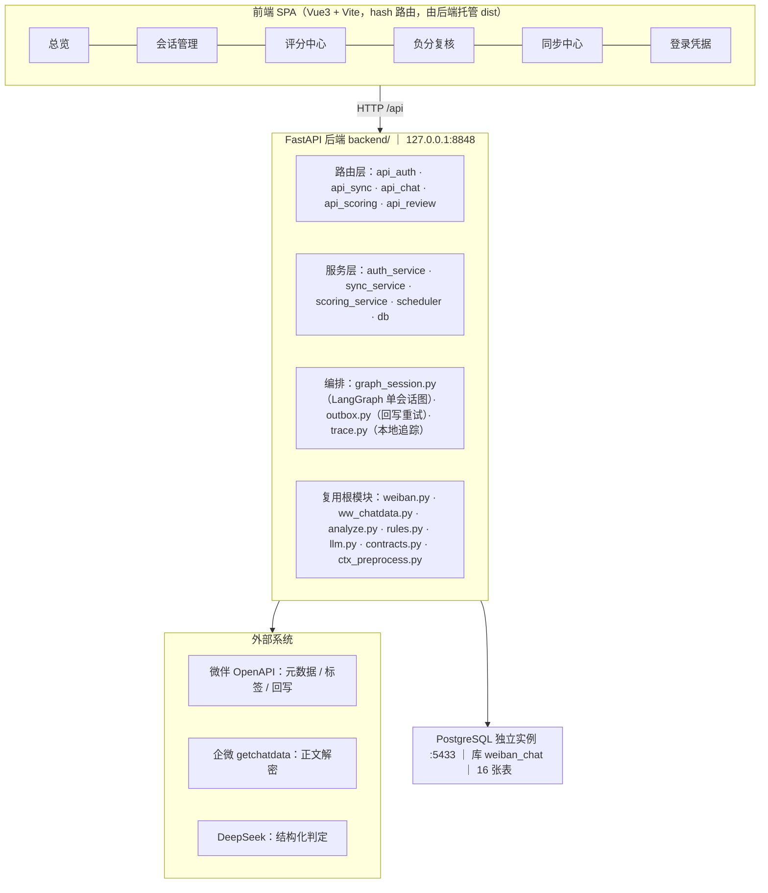
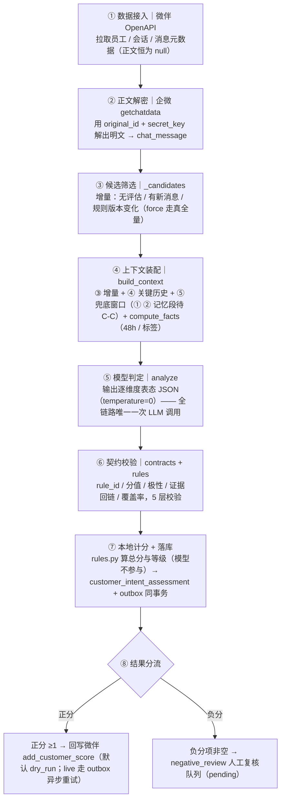
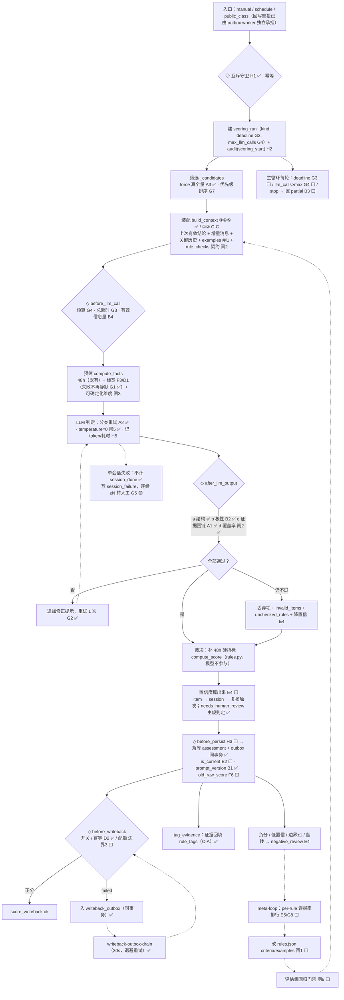
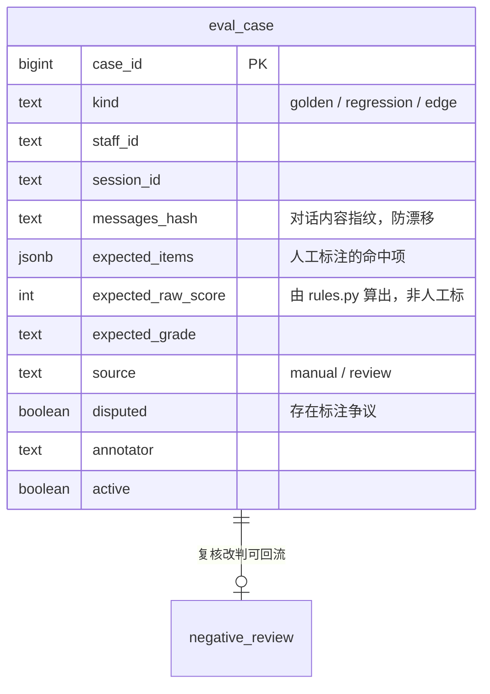

# 客户意向评分系统 · 架构设计说明书

> 工作区：`C:/zero/workbuddy/kechengdemo`  
> 版本：**v1.2（设计 + 实施实况）**  
> 整理日期：2026-10-14（v1.2 修订同日）  
> 状态：**设计持续生效；阶段A / 阶段B / G0 / C-A / C-B / C-C / §5 评估集 / §6 置信度 / Loop 护栏（G3/G4/B3/G7/H2）/ §2.4 显式钩子（H3）已落地并验收**
>
> **v1.2 变更（本文档开始记录"实况"，不再是纯设计稿）**
>
> 1. **第一章「现状」按当前源码重写**：13 表 → **16 表**，3 job → **4 job**，补预处理层 / LangGraph 图化 /
>    回写 outbox / trace。原「现状」写的是阶段A、阶段B 之前的状态，已过期。
> 2. **全文的「现有行号」一律改为「模块 · 函数名」引用**。代码在持续演进，行号必然失效
>    （实测：脚本文档里所有 `L265–296` 一类引用**已经全部对不上**）。引用函数名才是稳定的。
> 3. **已落地项就地打勾**（✅ 已落地 / 🟡 部分落地 / ⬜ 未做），并注明实现方式与**偏离文档之处**。
> 4. **冲突处按已拍板决策改写文档**（见本页「已拍板」小节），不再保留与代码冲突的旧描述。
>
> **已拍板（2026-10-14，与用户确认）**
>
> | # | 冲突点 | 拍板结果 |
> |---|---|---|
> | 1 | 回写重试载体：文档 §7 的 `score_writeback.next_retry_at` **vs** 阶段B 已交付的 `writeback_outbox` | **保留 `writeback_outbox`**，删除文档原方案（那节写在阶段B 之前，且 outbox 已跨进程验收） |
> | 2 | ① 段「客户档案」的数据源 | **先用最新 `customer_intent_assessment` 降级**（本文档 §4.5.1 本就允许），**暂不建 `customer_memory`** |
> | 3 | **D2-1 差值累加回写** | **延后**至开 `live` 前（当前默认 `dry_run`，不产生真实副作用） |
> | 4 | 互斥守卫的位置 | 目标链路画在**入口层**（manual + schedule 共用）→ 已在 service 层补对称互斥 |
> | 5 | ⑤ 兜底窗口的触发阈值 | 取 `ctx_window`(60) 而**非** §4.5.2 伪码的 `min_kept`(4)**——见 §4.5.4 的偏离说明，C-C 后应收紧 |
> | 6 | ④ 裁剪的「rule 权重」 | **✅ 已决（D4）**：`rules.json` 无 `weight` 字段，**取消该步、不引入权重**，改为「④ 收缩后继续砍 ③」；理由见 §4.5.4 与第十章 |
> | 7 | **⑤ 阈值已于 C-C 后收紧** | 新增 `ctx_fallback_min`（**默认 4** = 文档口径）；设 60 可一键退回。见 §4.5.2 偏离说明 1 |
>
> **v1.1 变更**：新增**第四章　上下文装配层设计（关键历史检索 + 裁剪器）**——  
> 把第二章 2.3「上下文层（当前最弱）」展开为可实现的工程方案（SQL / 算法 / 预算 / 验收），  
> 并给出记忆方案 §4.5 四段装配的**落地版**（拆为三步，前两步零依赖）；  
> 原第四～九章顺延为第五～十章。
>
> 配套文档（交叉引用，本文件不改动它们）：
>
> - `客户意向评分_优化建议.md` —— 问题清单（编号 A/B/C/D/E/F/G/H）
> - `客户意向评分_落地实施方案.md` —— 规则强制 / 评估集 / 置信度 / 安全 / 节奏
> - `客户意向评分_记忆系统设计方案.md` —— 记忆系统 v1.1（M0–M5，决议 M-A~M-D）
> - `客户意向评分_RAG与知识层选型评估.md` —— 为什么不用 RAG / 向量库 / GraphRAG
> - `客户意向识别系统需求文档.md` —— 需求原文（§5 判分规则、§6 输入输出、§9.3 规则表字段）
>
> **一句话结论：架构形态不动（仍是「单 Agent + 确定性编排」），把每一层的「强制力与可见性」补齐。**  
> **上下文装配层是全系统唯一"取什么给模型看"的地方——本章把它从"按位置（最近 60 条）"升级为"按价值（该看的都看得到 + 不超预算）"。**

---

## 目录

- [第一章　现状架构](#第一章现状架构)
- [第二章　目标架构（八层）](#第二章目标架构八层)
- [第三章　目标判定链路](#第三章目标判定链路)
- [第四章　上下文装配层设计（关键历史检索 + 裁剪器）](#第四章上下文装配层设计关键历史检索--裁剪器)
- [第五章　评估集设计](#第五章评估集设计)
- [第六章　置信度设计](#第六章置信度设计)
- [第七章　新增数据表 / 字段 / 配置清单](#第七章新增数据表--字段--配置清单)
- [第八章　落地路线](#第八章落地路线)
- [第九章　明确不做](#第九章明确不做)
- [第十章　待拍板（阻塞项）](#第十章待拍板阻塞项)

---

# 第一章　现状架构

## 1.1 一句话定位

系统是**两段拼起来的**：

| 段           | 做什么                                         |
| ----------- | ------------------------------------------- |
| 前段 · 会话存档系统 | 把微伴 + 企微的聊天记录搬进自建 PostgreSQL                |
| 后段 · 客户意向评分 | 读库里的聊天记录 → 按 `rules.json` 打分 → 回写微伴 / 进人工复核 |

**地基事实（整套系统最不可替代的一环）**：  
微伴 OpenAPI 永远拿不到聊天正文（`content` / `text_content` 恒为 `null`），  
正文必须走企微「会话存档展示组件」的 `getchatdata` 解密链路：

```
微伴 OpenAPI 给 original_id（= 企微 msgid）与 secret_key（= 解密密钥）
        ↓
企微 /wwopen/monoApi/openData/frame/createOpenChatSession 换 sid
        ↓
企微 /chatdata/getchatdata 用 sid + original_id 拿回明文
```

「微伴给锁和钥匙，开锁的是企微」。

## 1.2 分层现状

> 本节为 **v1.2 实况**（2026-10-14）。原 v1.1 版本写的是阶段A / 阶段B 之前的状态，已失效。



| 层     | 现状要点（v1.2 实况）                                                                                                                                                |
| ----- | ------------------------------------------------------------------------------------------------------------------------------------------------------------- |
| 前端    | Vue3 + Vite，hash 路由 6 页；`npm run build` 后由后端 8848 托管 `frontend/dist`（**改前端后必须重启后端才生效**）                                                                    |
| 后端    | FastAPI；路由 5 个模块 / 服务 5 个模块；直接 import 根目录既有模块，不重写                                                                                                              |
| 编排    | **`backend/graph_session.py`**（阶段B）：单会话 11 节点 LangGraph 图，**默认关**（`use_graph_session=false`，旧串行 `_score_one` 保留为回滚点）；`backend/outbox.py` 回写 outbox；`backend/trace.py` 本地 trace        |
| 复用根模块 | `weiban.py`（微伴 OpenAPI）、`ww_chatdata.py`（企微正文解密）、`wb_keepalive.py`（凭据保活）、`analyze.py`（提示词 + LLM 分析）、`contracts.py`（输出双层契约）、`rules.py` + `rules.json`（规则引擎）、`llm.py`（DeepSeek 客户端）、**`ctx_preprocess.py`**（「消息→文本」唯一入口） |
| 存储    | PostgreSQL 独立实例 `:5433`（容器 `weiban-chat-pg`），库 `weiban_chat`，**16 张表**                                                                                        |
| 调度    | APScheduler **4 个 job**：`auto-incremental-sync` / `credential-keepalive` / `auto-scoring` / **`writeback-outbox-drain`**（30s，阶段B）                             |
| 运行环境  | 后端跑在**项目级 `.venv`**（`C:/zero/workbuddy/kechengdemo/.venv`，Python 3.13.14）；仅 PostgreSQL 是容器                                                                            |

**16 张表**：`staff` / `chat_session` / `chat_message`（+ `rule_tags TEXT[]` + GIN） / `sync_cursor` / `sync_job` / `credential` /  
`scoring_rule` / `customer_intent_assessment` / `score_writeback` / `negative_review` /  
`scoring_run` / `session_failure` / `writeback_outbox` / `trace_span` / `audit_log` / `app_setting`。

> 相比 v1.1 的「13 张表」：新增 `session_failure`（阶段A 修 G5）、`writeback_outbox`（阶段B 修 G6）、`trace_span`（阶段B）。

## 1.3 业务主链路（8 步）



对应代码位置（**引用函数名，不再写行号**——行号在持续演进中必然失效）：

| 步骤       | 函数 / 模块                                       | 位置                                              |
| -------- | --------------------------------------------- | ----------------------------------------------- |
| ③ 候选筛选   | `ScoringService._candidates`                  | `backend/scoring_service.py`                    |
| ④-a 上下文装配 | `build_context`（→ `ctx_preprocess.build_llm_context`） | `backend/scoring_service.py` / `ctx_preprocess.py` |
| ④-b 事实   | `compute_facts`                               | `backend/scoring_service.py`                    |
| ⑤ 模型判定   | `ScoringService._llm_analyze` → `analyze.analyze` | `backend/scoring_service.py` / `analyze.py`     |
| ⑥ 契约校验   | `contracts`（双层 pydantic）+ `rules.validate_items` / `check_coverage` | `contracts.py` / `rules.py`                     |
| ⑦ 计分     | `rules.compute_score` / `rules.grade_of`      | `rules.py`                                      |
| ⑦ 落库     | `ScoringService._persist_assessment`（assessment + outbox 同事务） | `backend/scoring_service.py`                    |
| ⑧ 回写     | `ScoringService._writeback` → `backend/outbox.py` | `backend/scoring_service.py` / `outbox.py`      |
| ⑧ 复核入队   | `ScoringService._enqueue_review`              | `backend/scoring_service.py`                    |
| ⑧ 标签回填   | `ScoringService._tag_evidence_messages`（C-A） | `backend/scoring_service.py`                    |
| 主循环      | `ScoringService._run` → `_score_cand`（灰度分派图/旧路径） | `backend/scoring_service.py` / `graph_session.py` |

## 1.4 现状判断

**形态是对的，不必改：**

- **单 Agent + 确定性编排**：`_score_one` 是「输入（会话 + 规则表 + 事实）→ 输出（命中项 JSON）」的  
  **单轮无依赖判定**，没有子任务、没有 DAG、没有等待条件。多 Agent 只会让每个 Agent 看到同一份上下文却只看局部规则。
- **模型无工具调用权**（[H4]）：取标签、解密、回写全部由代码显式调用，模型只输出 JSON。  
  即使被提示词注入，最坏也只在评分 JSON 里捣乱，**触达不到任何外部系统**。这是架构级优点。
- **推理与控制分离**：模型只给命中项 + 证据，总分/等级由 `rules.py` 本地算。
- **副作用受控**：回写默认 `dry_run`；`score_writeback UNIQUE(assessment_id)` 幂等。

**v1.1 列出的 8 个问题，当前状态**（原表保留、就地标注）：

| 现象                                                         | 位置                            | 编号    | 状态 |
| ---------------------------------------------------------- | ----------------------------- | ----- | -- |
| `except Exception: pass` 静默吞掉取标签失败，分数被静默降级                 | `compute_facts`               | G1    | ✅ 已修（G0，失败写 `tool_failure` + 事实文本标注降级） |
| 单会话异常同时 `llm_failed+1` 与 `session_done+1`，完成率永远好看          | `_run`                        | G5    | ✅ 已修（阶段A：失败不计 `session_done`，写 `session_failure`） |
| 回写失败后水位已推进，`ON CONFLICT DO NOTHING` 让手动重跑也不落新记录 → **永久丢失** | `_writeback` + `_candidates`   | G6    | ✅ 已修（阶段B：同事务入 `writeback_outbox` + 独立 drain worker，跨进程验收） |
| `force` 参数收了但函数体从未引用，「全量重评」不生效                             | `_candidates`                 | A3    | ✅ 已修（G0：`force=True` 去掉增量条件走真全量；实测 756 → 783） |
| `evidence` 不校验是否出自原文                                       | `analyze.py`                  | A1    | ✅ 已修（阶段A：证据回链 `evidence_ids` → 原文行回填，回链不上进 `invalid_items`） |
| 历史评估结论只写不读，每次重评都从零开始                                       | `build_context`               | E1/F1 | 🟡 部分落地（C-B 已做 ③⑤；① ② 记忆段待 C-C） |
| 定时同步只查同步自己在不在跑，不查评分                                        | `scheduler`                   | H1    | ✅ 已修（G0：共享守卫 `guard_can_start(owner)` + service 层对称互斥） |
| 评分链路全程不写 `audit_log`                                       | `scoring_service` 全链路         | H2    | ⬜ 未做 |

---

# 第二章　目标架构（八层）

> 形态不变，补齐每层的护栏与可见性。**橙色＝新增/改造，绿色＝已达标保持。**


## 2.1 入口层

| 项        | 现有（v1.2 实况）                                        | 目标改动                                                                                                                                                                                                 |
| -------- | --------------------------------------------------- | ---------------------------------------------------------------------------------------------------------------------------------------------------------------------------------------------------- |
| 互斥守卫     | ✅ **已修**（G0）：共享 `scheduler.guard_can_start(owner)`；`sync_service.start` / `scoring_service.start` 也补了对称互斥。⚠️ **v1.2 追加修复：原来是「进程内」判定**（只看 `self._thread`），后端与脚本/调度器跑在不同进程时**互相看不见** → 实测出现「脚本里的批量在跑，另起后端又能启动新批量」。现 `is_running()` 追加 DB 判定（有 `status='running'` 即视为在跑）+ **僵尸超时**（超 `scoring_stale_minutes` 默认 240 分钟自动标 failed 并放行，否则崩溃残留会永久阻塞启动）；`stop()` 同步改为写 `scoring_run.stop_requested`、由 `_run` 每轮检查，**跨进程停止才生效** | 保持；后续新增入口一律走同一守卫 |
| 定时任务     | **4 个 job**：同步 / 保活 / 评分 / **`writeback-outbox-drain`**（阶段B 已把「回写重试」实现为 outbox drain，替代本文档原设想的 `writeback-retry`） | 增至 **5 个**：+ `morning-sa-review`（**触发时刻 UI 可配**，扫 S/A 走增量刷新）**[F2]**、+ 手动入口 `POST /api/scoring/public-class-review`（公开课不定期，课前/课后两种模式）**[F2]**。**`writeback-retry` 不再新增**（已由 outbox 覆盖） |
| 手动端点     | `/start /stop /settings /schedule`                  | 关键操作（切 `live`、改 `rules.json`、改参数）写 `request_key` 幂等 + 写 audit **[H2]**                                                                                                                               |
| 触发来源     | `manual` / `schedule`                               | 增加 `public_class` 一类 `triggered_by`（`writeback_retry` 已由 outbox worker 自身的调度承担）                                                                                                                        |
| ~~角色权限~~ | 无登录体系                                               | **本轮明确不做**（见第九章），`audit_log.actor` 仍记录 `manual`/`schedule`，用于追溯"改了什么"                                                                                                                                |

## 2.2 编排层

| 项    | 现有（v1.2 实况）                                                  | 目标改动                                                                                                     |
| ---- | --------------------------------------------------- | -------------------------------------------------------------------------------------------------------- |
| 主循环  | ✅ **已加护栏**：`ScoringService._run` 每轮检查 `deadline`（G3）与 `llm_calls >= max_llm_calls`（G4），超限优雅退出并置 `partial` + `partial_reason`；判定抽成纯函数 `guard_reason()`（可单测）。停止/护栏查询**合并为一次 DB 往返** | ✅ 已完成（批量外壳仍未图化，保持 for 循环） |
| 会话执行 | ✅ `_score_cand` 灰度分派：`use_graph_session=false` → 旧 `_score_one`；`true` → `graph_session.run_session`（11 节点，`test_graph_session_parity` 30 条差异 0） | 观察一个评分周期后把默认值翻成 `true`                                                                         |
| 失败口径 | ✅ **已修**（阶段A）：失败不计 `session_done`，改计 `session_failed` 并写 `session_failure` 明细 | 连续失败 ≥N 转人工的**重投 worker** 尚未做（明细已齐备）                                                          |
| 任务状态 | ✅ **`partial` 已加**：`running / success / stopped / partial / failed` 五态；`partial_reason` 记录是超时还是预算触发；**`partial` 不阻塞后续启动** | ✅ 已完成 **[B3]** |
| 候选筛选 | ✅ `force` **已真全量**（G0，实测 756→783）；✅ **优先级排序已加**（G7）：`ORDER BY` 由「仅 `last_msg_time DESC`」改为 S/A → 有新消息 → 未评过 → 规则变更 → 最后时间；可配 `scoring_priority_order` 一键退回 | ✅ 已完成 **[G7]**（回写重投已由 outbox 独立承担，SQL 不必再管） |
| 审计   | ✅ **三节点已加**（H2）：`scoring_start`（参数字典）/ `scoring_done`（计数与 `partial_reason`）/ `scoring_failed`（异常类与消息）；`_audit()` **写库失败不影响评分** | ✅ 已完成 **[H2]**；`set_settings` 的 key 级留痕已在 api_scoring 实现 |

## 2.3 上下文工程层（v1.2：③④⑤ 已落地，①② 待 C-C）

| 项     | 现有（v1.2 实况）                                       | 目标改动                                                                                                                                                                                                                               |
| ----- | ---------------------------------------- | ---------------------------------------------------------------------------------------------------------------------------------------------------------------------------------------------------------------------------------- |
| 上下文装配  | ✅ **`build_context()` 已落 ③④⑤**（C-A / C-B）：③ 增量（水位 `last_msg_time`）+ ④ 关键历史（`rule_tags`）+ ⑤ 兜底窗口 + 合并去重 + 统一编号 + 预算记账 | 补 **① 客户档案**（先用最新 `assessment` 降级）与 **② 上次评分明细** **[E1/F1]**；④ 的分组收缩与按权重砍（权重口径待定，见 §4.5.4） |
| 「消息→文本」 | ✅ 唯一入口 `ctx_preprocess.build_llm_context`（⑤ 段也不绕开它） | 保持；任何新段落必须走同一入口                                                                                                         |
| 规则可机读 | 每档只有一句 `criteria` 自然语言                   | 每档补 **`examples`**（positive / negative / ambiguous）**[闸1 / F5]**                                                                                                                                                                   |
| 输出契约  | ✅ **已改逐维度表态**（阶段A）：`rule_checks` 逐维度 hit/no-hit + `check_coverage` 校验覆盖率 | 保持；`unchecked_rules` 已可数                                                                           |
| 契约版本  | 🟡 已落 `prompt_version` / `schema_version`；**`model_name` 未落** | 补 `model_name` **[B1]**                                                                                                                                                                                         |
| 采样温度  | ✅ **已改 `temperature=0`**（阶段A）                   | 保持 **[闸5]**                                                                                                                                                                                                           |
| 画像    | 🟡 已有 `profile_summary` + `sales_strategy`；**未拆结构化带证据字段** | 拆结构化带证据字段，自由文本降级为 `summary` **[E3]**                                                                                                                                                                                               |
| 有效信息量 | `len(conv) < 20` 按字符数判                   | 改「消息数 + 客户发言数 + 文本长度」综合阈值 **[B4]**（现有 `ctx_min_kept` 是「规范化后保留条数」，非同一口径）                                                                                                                                                                                                 |

## 2.4 Harness（模型之外的控制）

| 子层           | 现有（v1.2 实况）                                       | 目标改动                                                                                                                                                                                                                                                           |
| ------------ | ---------------------------------------- | -------------------------------------------------------------------------------------------------------------------------------------------------------------------------------------------------------------------------------------------------------------- |
| 上下文组装        | ✅ 见 2.3（工程方案见第四章）                      | 见第四章                                                                                                                                                                                                                                                           |
| 工具调用         | ✅ **已异常分类**（阶段A）：`llm.RetryableLLMError` 退避重试 / `FatalLLMError`·`ContractViolationError` 立即上抛转人工；JSON 解析失败 → 契约修复重试（`rejudge_retries`） | 保持。 |
| **钩子 Hooks** | ✅ **已落地**（H3）：`backend/hooks.py` 四个显式钩子，统一返回 `HookResult(allow, reason, detail)`。<br />`before_llm_call`（超时 G3 / 预算 G4 / 有效信息量 B4）<br />`after_llm_output`（结构 闸4 / **极性终检** B2 / 证据 A1 / 覆盖率 闸2）<br />`before_writeback`（开关 D2 / **幂等** / **配额** 边界3）<br />`before_persist`（落库前完整性 H3） | ✅ 已完成。**三条纪律**：① hook 是**纯函数**（I/O 与配置由调用方注入 → 可穷举单测，`hooks.py` 只 import 标准库）；② **不复制**已有校验（契约/极性/回链/覆盖仍由原实现负责，hook 只汇总 + 极性终检）；③ **行为逐字不变**（`REASON_TO_WB_STATUS` 映射与改造前 if-else 逐组合对比，见 `test_hooks.py` 的表驱动断言） |
| 校验           | ✅ **已加**极性校验（B2）、证据回链 `verify_evidence`（A1）、覆盖率 `check_coverage`（闸2）、pydantic 双层契约（阶段A） | 保持；`compute_score` 的静默截断改为断言 / 留痕                                                                        |
| 权限           | 无登录，`actor` 写死                           | **本轮不做**（见第八章）                                                                                                                                                                                                                                                 |
| 可观测          | 见 2.7                                    | 见 2.7                                                                                                                                                                                                                                                          |

## 2.5 工具层

`weiban.py` / `ww_chatdata.py` / `llm.py` / `wb_keepalive.py`：统一 client wrapper  
（超时 / 分类重试 / 结果校验 / 审计 / metrics）**\[A2\]\[H2\]\[H5]**；  
✅ `compute_facts` 取标签失败**已不再 `except: pass`**（G0），改记录 `tool_failure` 并在事实文本标注降级 **[G1]**；  
✅ `add_customer_score` 语义**已确认＝累加**（D2）→ 差值回写待 **D2-1**（开 live 硬前提）；
✅ **回写副作用配额已落地**（边界3）：`writeback_quota_per_run` / `writeback_quota_per_customer_per_day`，
   由 `hooks.before_writeback` 判定，**默认 0 = 不限**（不改变既有行为）；超时保留 `TIMEOUT=30`。


## 2.6 状态存储层

见[第七章](#第七章新增数据表--字段--配置清单)。核心变化：  
评估「只写不读」→ **读回** **[E1]**（🟡 ③⑤ 已做，①② 待 C-C）；无时效 → **`is_current`** **[E2]**；  
回写重试 → ✅ **`writeback_outbox`** **[G6]**（阶段B，替代原设想的 `score_writeback.next_retry_at`）；  
失败无载体 → ✅ **`session_failure`** **[G5]**（阶段A）；  
缺版本 → **`prompt_version`** ✅ / `model_name` ⬜ **[B1]**；  
可观测 → ✅ **`trace_span`**（阶段B，默认关）。

## 2.7 可观测层

- `scoring_run` 扩展：✅ 护栏（`deadline` / `max_llm_calls` / `session_failed` / `partial_reason` 四列已落）、
  ✅ **钩子观测**（§2.4 H3）：`hook_denials`（拒绝原因分布）、`hook_sessions` / `hook_coverage_sum` / `hook_invalid_total`（模型输出体检：平均覆盖率、无效项总量）、
  token 消耗 ✅（`prompt/completion/total_tokens`）、覆盖率 ✅（`unchecked_rules`）、
  真实完成率 ✅（`session_failed` + `session_failure`）、**单会话耗时分布** ⬜、**工具调用失败率** ✅（`tool_failures`）· **上下文分段指标** ✅（C-A/C-B 的 `ctx_seg_*` / `ctx_key_rules` / `ctx_tokens_peak` / `ctx_trim`） **\[H5\]\[G5]**
- `audit_log` 补全：评分链路三节点 + 参数变更 **[H2]** ⬜
- **meta-loop 复盘回流**：按 `rule_id` 聚合复核改判 → 误报率排行榜 → 回流改 `rules.json` 的 `criteria`/`examples` **[E5/G8]** ⬜
- **回归门禁**：改规则前必须跑评估集，指标不降才允许发布 **[闸6]** ⬜

## 2.8 安全层（三道边界）

| 边界       | 现状（v1.2）               | 目标                                                                                                                   |
| -------- | ---------------- | -------------------------------------------------------------------------------------------------------------------- |
| 模型与副作用隔离 | ✅ 已做到            | **保持不动**；任何新功能不得给模型开 function calling 通道 **[H4]**                                                                    |
| 副作用开关与配额 | 🟡 `dry_run` 默认有 ✅；**回写不再原地重试**（阶段B 交 outbox 异步，避免拖慢批量） | 加单轮 / 单客户回写配额，超限降级 `dry_run`；上 `live` 前必须先验证 **[边界3 / D2]**                                                          |
| 密钥与出口    | ✅ **已补 `.gitignore`**（E6）：`.cache/` `.env` `__pycache__/` `.venv/` `frontend/node_modules/` `frontend/dist/` `requirements.lock.txt` | 检查 git 历史 + 轮换密钥（**待用户执行**） **[E6]** |

> ❌ **角色权限（管理员 / 复核员 / 只读）本轮不做** —— 见第九章。

## 2.9 Loop 八条护栏对照

| 护栏     | 现状（v1.2）                 | 目标                           |
| ------ | ------------------------ | ---------------------------- |
| 状态机    | ✅ `scoring_run`；**`partial` 已加**（G3/G4 触发） | ✅ 已完成                        |
| 循环上限   | ✅ `max_sessions`；**`max_llm_calls` 已加**（G4） | ✅ 已完成                        |
| 超时     | ✅ **整轮 `deadline` 已加**（G3）：`_run` 每轮检查，超时置 `partial` + `partial_reason` | ✅ 已完成                     |
| ~~权限~~ | ❌ 无登录                    | **本轮不做**（保持无登录）              |
| 成本预算   | ✅ `max_llm_calls` 上限已加；token 用量已记（`prompt/completion/total_tokens`） | ✅ 已完成（token 上限未单列，靠调用次数约束） |
| 检查点    | ✅ **已修**（阶段B）：`writeback_outbox` 独立 drain，回写不再永久丢失 | 保持；**节点级断点续跑未做**（无 checkpointer） |
| 护栏规则   | ✅ **已收敛为 4 个显式 Hook**（H3）：`backend/hooks.py`。判定纯函数化、拒绝可观测（`hook_denials`）、两条路径共用同一入口 | ✅ 已完成               |
| 人工审批   | ✅ `negative_review`；**触发条件已扩**（低置信 / 边界 / 等级翻转 / 弱证据，§6） | ✅ 已完成                        |

**结论：不追动态分支，只补护栏完整性。** 会话之间无依赖、天然可并行，是该任务形态带来的红利。

---

# 第三章　目标判定链路

> ◇＝新增检查点　↺＝回环



> ✅＝已落地　🟡＝部分落地　⬜＝未做（截至 v1.2）

**链路里只有一格是模型**（⑤ LLM 判定），其余全是确定性代码。这是本设计最重要的一条不变量。

---

# 第四章　上下文装配层设计（关键历史检索 + 裁剪器）

> 本章把第二章 2.3「上下文层（当前最弱）」从一行结论展开成**可实现的工程方案**：给出 DDL、SQL、装配算法、  
> 预算与裁剪顺序、验收口径，并给出记忆方案 §4.5「四段装配」的**落地版**（拆为三步，前两步零依赖）。  
> 对应问题编号：**E1 / F1**（只写不读）· **B4**（有效信息量）；需求 **§6.1** 第 3、4、5 条。

> **本章落地状态（v1.2）**
>
> | 段 | 名称 | 数据来源 | 状态 |
> |---|---|---|---|
> | **①** | 客户档案 | `customer_memory`（降级：最新 assessment） | ⬜ C-C |
> | **②** | 上次评分明细 | `customer_intent_assessment` 最新 1 条 | ⬜ C-C |
> | **③** | 增量消息 | `chat_message WHERE msg_time > watermark` | ✅ C-B |
> | **④** | 关键历史消息 | `chat_message.rule_tags` + GIN（部件 A） | ✅ C-A |
> | **⑤** | 兜底窗口 | `chat_message` 最近 60 条 | ✅ C-B |
>
> **部件 A（§4.4，关键历史检索）已全部落地；部件 B（§4.5，装配器）五段 + 预算 + 裁剪已全部落地**
> （①②③④⑤ ✅，裁剪四步 ✅）。§4.5.6（提示词说明）已落地（`PROMPT_VERSION` v2→v3）。

## 4.1 现状为什么不够：三个可复现的失效

> **v1.2**：X1 已由 C-A/C-B 解决（④ 关键历史 + ④′ 早期锚点）；X2 待 C-C（①② 记忆段）；
> X3 已由 C-A 解决（`rule_tags` 即"检索键"）。

现状 `build_conversation(limit=60)` ＝ **按位置取数**（最近 60 条）。它有三个失效：

| #      | 失效                 | 触发条件                                             | 后果                                                                                               |
| ------ | ------------------ | ------------------------------------------------ | ------------------------------------------------------------------------------------------------ |
| **X1** | **早期关键事实被挤出窗口**    | `msg_count > 60`（实测 p99=171、max=320，约占 1%~3% 会话） | 「岗位 / 需求 / 预算」这类**最早出现且最重要**的事实不在上下文里 → 直接漏判 `positive_coder_profile`、`positive_clear_work_need` |
| **X2** | **记忆只写不读** [E1/F1] | 每次重评                                             | 读不到"该客户上次是什么状态"→ 无法识别**态度转变**（S→C），也无法阻止同一证据被重复计分                                                |
| **X3** | **"相关历史关键消息"无处可取** | 需求 §6.1 第 5 条                                    | 窗口之外的重要片段（报价、邀约、到课、拒绝）只能靠运气落在 60 条内；且**没有任何检索键**                                                 |

> **实测基线**（`chat_message` 真库）：消息 32,758 条 / 会话 782 个；单会话消息数 p50=**35**、p90=77、p99=171、max=**320**；  
> 单条正文均 169 字；单会话正文均 7,083 字、max 38,194 字（≈4.7k / 25k token）。  
> → **中位数根本没超窗口，问题只在长尾**。因此本章方案必须满足「**短会话零成本、长会话才生效**」（见 4.5.4(4)）。

## 4.2 设计契约（先说不能破坏什么）

| 契约           | 内容                                                                       | 为什么                                                                                                |
| ------------ | ------------------------------------------------------------------------ | -------------------------------------------------------------------------------------------------- |
| **C1 对齐需求**  | 输出必须覆盖 §6.1 五条输入（映射见 4.5.1）                                              | 这是需求硬要求，不是优化项                                                                                      |
| **C2 证据可回链** | 每一行可被模型引用的消息都带 `#编号`，且编号**在整份上下文内唯一**                                    | `analyze._attach_evidence` 靠 `index` 把 `#编号` 映射成 `message_id`；编号一冲突，证据回链（A1）即失效                    |
| **C3 唯一入口**  | 「消息 → 提示词文本」只能经 `build_context()` → `ctx_preprocess.build_llm_context()` | 已有三个同型前科：`force` 未使用(A3) / `scoring_fetch_tags` 默认 False(F3) / `except: pass`(G1)。**入口一多，护栏必然被绕开** |
| **C4 预算上界**  | 单会话 ≤ **12k token**（硬预算，≈18k 中文字符）                                       | 与现状"硬切 60 条"总量同量级，**不增加成本**                                                                        |
| **C5 可观测**   | 每段条数 / 字符数 / 估算 token / 裁剪次数必须落 `scoring_run.detail`                     | 否则"记忆到底有没有被读进去"无法验证                                                                                |
| **不做**       | 不做语义检索（RAG 已否，见选型文档）· 不做摘要压缩（第一期）· **不改分数**（决议 M-C）                      | —                                                                                                  |

## 4.3 两个部件

```
┌─ 部件 A：关键历史消息检索 ────────────────────────────────────┐
│  载体：chat_message.rule_tags TEXT[] + GIN 索引               │
│  查询：按「本次相关规则集」分组取数（每 rule 保底 1，总量 ≤30）  │
│  职责：回答「该看哪几条历史消息」——把位置规则换成价值规则        │
└──────────────────────────────────────────────────────────────┘
┌─ 部件 B：上下文裁剪器 build_context() ───────────────────────┐
│  五段装配 ①②③④⑤ → 去重合并 → 统一编号 → 预算检查 → 按序裁剪 │
│  职责：回答「在预算内把该看的都放进去」                        │
└──────────────────────────────────────────────────────────────┘
```

---

## 4.4 部件 A：关键历史消息检索

### 4.4.1 载体：`chat_message.rule_tags`

**（1）语义定义**

一条消息的 `rule_tags` ＝ **它曾经作为哪些规则的证据被采纳过**（即该消息的 `message_id` 出现在某次评估的  
`positive_items[].evidence_message_ids` / `negative_items[].evidence_message_ids` 里，且该项通过了 `_attach_evidence` 回链）。

> **关键约束：`rule_tags` 是"曾经被采纳"的历史事实，只增不减。**  
> ① 规则改版后旧标签仍有检索价值（那确实是客户说过的关键话）；  
> ② 标签**只决定候选集**，最终是否命中仍由模型基于证据重判 → 不会污染评分；  
> ③ 若支持删除，就要处理"哪次评估撤销了它"，成本远大于收益。

**（2）DDL**

```sql
ALTER TABLE chat_message
  ADD COLUMN IF NOT EXISTS rule_tags TEXT[] NOT NULL DEFAULT '{}';

-- 关键历史检索是「数组包含」语义 → GIN 是最合适的索引
CREATE INDEX IF NOT EXISTS idx_msg_rule_tags
  ON chat_message USING gin (rule_tags);
```

**（3）写入时机与幂等**

在 `_score_one` 落库 `customer_intent_assessment` 之后（建议挂在 `before_persist` 钩子 [H3] 之后、回写之前）：

```sql
-- 把本轮采纳的 (rule_id, message_id) 对，「只增不减」地合并进 rule_tags
UPDATE chat_message m
   SET rule_tags = (
         SELECT ARRAY(SELECT DISTINCT unnest(m.rule_tags || %(new_tags)s::text[]) ORDER BY 1)
       )
 WHERE m.staff_id = %(staff_id)s
   AND m.session_id = %(session_id)s
   AND m.message_id = ANY(%(message_ids)s);
```

- `new_tags` ＝ 该消息本轮对应的 `rule_id` 列表（同一条消息可同时作为多条规则的证据）
- **幂等**由 `ARRAY(SELECT DISTINCT unnest(...))` 保证：重复执行结果不变
- **失败不阻断评分**：标签写入失败只记 `tool_failure`，评分与回写照常——标签是"下一轮的检索键"，不是本轮结论

**（4）为什么是列而不是新表 `message_rule_tag`**

| 方案                                                           | 优点                                                  | 缺点                             |
| ------------------------------------------------------------ | --------------------------------------------------- | ------------------------------ |
| `chat_message.rule_tags TEXT[]` + GIN                        | 零 join；查询是"整行 + 包含判断"，正是 GIN 强项；与 `message_id` 天然同行 | 无法直接记录"哪次评估打的"                 |
| 新表 `message_rule_tag(message_id, rule_id, assessment_id, …)` | 可追溯来源                                               | 每次检索要 join + 去重；3 万条消息量级下收益不明显 |

→ **选列**。来源追溯由 `customer_intent_assessment.positive_items/negative_items`（已存 `evidence_message_ids`）承载，无需在标签上再记一遍。

### 4.4.2 查询：「本次相关规则集」怎么定

| 候选     | 内容                                             | 判断                                   |
| ------ | ---------------------------------------------- | ------------------------------------ |
| K1     | 全部非 `engine=rule` 规则（14 条）                     | ❌ 太宽：每个维度都拉 3 条会把配额吃光，而大部分维度该客户从未表现过 |
| **K2** | **上次评估命中的 `rule_id`** ∪ **本会话 `rule_tags` 全集** | ✅ 正是"该客户历史上表现过信号的维度"                 |
| K3     | 让模型先选维度再检索                                     | ❌ 要多一次 LLM 调用，且引入不确定性                |

→ **定 K2**（当前规则表 15 条，天然不超上限）。

### 4.4.3 两阶段取数（避免"高频规则吃光配额"）

朴素做法 `ORDER BY msg_time DESC LIMIT 30` 会让**消息最多的那个规则**占满 30 条，其余维度一条都进不来。故分两阶段：  
**阶段 1（保底）**&#x6BCF;个相关 `rule_id` 取**最近 1 条**（≤15 条）→ **阶段 2（补足）**&#x5269;余额度按 `msg_time DESC` 补到 30 条。

```sql
WITH rel AS (SELECT unnest(%(rule_ids)s::text[]) AS rule_id),
     hit AS (
       SELECT m.staff_id, m.session_id, m.message_id, m.msg_time, t.rule_id
         FROM chat_message m
         CROSS JOIN LATERAL unnest(m.rule_tags) AS t(rule_id)
        WHERE m.staff_id = %(staff_id)s
          AND m.session_id = %(session_id)s
          AND m.rule_tags && %(rule_ids)s::text[]
     ),
     first_per_rule AS (                       -- 阶段 1：每 rule 最近 1 条
       SELECT DISTINCT ON (rule_id) * FROM hit
        ORDER BY rule_id, msg_time DESC, message_id DESC
     ),
     rest AS (                                 -- 阶段 2：其余按时间倒序
       SELECT h.* FROM hit h
        WHERE NOT EXISTS (SELECT 1 FROM first_per_rule f
                           WHERE f.message_id = h.message_id AND f.rule_id = h.rule_id)
        ORDER BY h.msg_time DESC, h.message_id DESC
     ),
     merged AS (
       SELECT * FROM first_per_rule
       UNION ALL
       SELECT * FROM (SELECT * FROM rest LIMIT GREATEST(%(max_total)s - %(n_rules)s, 0)) r
     ),
     dedup AS (                                -- 同一消息命中多规则 → 合并成一行
       SELECT message_id, msg_time, array_agg(DISTINCT rule_id) AS tags
         FROM merged GROUP BY message_id, msg_time
     )
SELECT message_id, msg_time, tags FROM dedup
 ORDER BY msg_time ASC, message_id ASC
 LIMIT %(max_total)s;
```

- `max_total` = **30**（`ctx_key_history_max`）· 每 rule 保底 1 条 · `n_rules` = 相关规则数
- 输出**按时间升序**，便于与 ③ 段合并后统一编号
- 实际命中数通常 **9~18 条**（单会话一般只表现 3~6 个维度），30 是上限而非常态

### 4.4.4 冷启动：`rule_tags` 全空怎么办

首次评分（或历史数据未打标签）时 ④ 段为空。此时：

- ③ 段的起点 `watermark` 为空 → **增量 = 全量**，与现状等价 → **短会话（≤200 条）不受影响**
- 只有"**首次评分且消息数 > 200**"才会丢早期事实。给一条等价补丁：

> **④′ 早期锚点**：当 ④ 命中数为 0 时，取该会话**最早的 10 条**可读消息（`ctx_cold_start_early=10`）。  
> 理由是"岗位 / 需求 / 预算"这类最重要的事实几乎总在会话开头。

④′ 与 ④ **互斥**（有 ④ 就不启用），并计入同一 30 条配额。

---

## 4.5 部件 B：上下文裁剪器 `build_context()`

### 4.5.1 五段定义与需求 §6.1 的映射

| 段     | 名称     | 数据来源                                      | 依赖        | 上限                  | 状态 |
| ----- | ------ | ----------------------------------------- | --------- | ------------------- | -- |
| **①** | 客户档案   | `customer_memory`（一客户一行）；**降级：最新 assessment** | 记忆方案 M0（**已降级绕过**） | ≈700 token（画像/策略各 400 **字**上限），**不裁剪** | ✅ C-C（降级读） |
| **②** | 上次评分明细 | `customer_intent_assessment` 最新 1 条       | **已有表**   | ≈300 token，**不裁剪**  | ✅ C-C |
| **③** | 增量消息   | `chat_message WHERE msg_time > watermark` | 已有        | **200 条软上限**        | ✅ C-B |
| **④** | 关键历史消息 | `chat_message.rule_tags`（部件 A）            | **本章新增列** | **30 条**（每 rule ≤3） | ✅ C-A |
| **⑤** | 兜底窗口   | `chat_message` 最近 60 条（现状）；触发阈值 `ctx_fallback_min`(4) | 已有        | 60 条                | ✅ C-B |

**需求 §6.1 逐条对应：**

| 需求 §6.1 原文要求                  | 落在哪段        | 现状（v1.2）                  |
| ----------------------------- | ----------- | ------------------- |
| 本次聊天记录                        | ③ + ⑤       | ✅ 落地（③ 增量 + ⑤ 兜底）        |
| **上一次有效评分、等级、画像总结、已通知等级**     | **① + ②**   | ✅ 落地（①② 记忆块）；「已通知等级」随 F6 待做 |
| **自上次分析后的新增消息**               | **③**       | ✅ 落地（水位 = `last_msg_time`） |
| **相关历史关键消息（需求、报价、邀约、到课、拒绝等）** | **④**       | ✅ 落地（`rule_tags` 精确检索 + ④′ 冷启动） |
| 不得无限量发送全部历史聊天记录               | 预算 + 裁剪（C4） | ✅ 落地（`ctx_tokens_max` 12000 硬预算 + 四步裁剪） |

> **降级链（保证渐进可落地）**：`customer_memory` 表不存在时，① 用 `customer_intent_assessment` 最新一条的  
> `profile_summary` / `grade` / `raw_score` 拼出"准档案"，② 同源取 `positive_items` / `negative_items`。  
> → **① ② 段不依赖记忆方案 M0 也能先上。**
>
> **v1.2 实况**：**就是走的降级路径**（2026-10-14 拍板：暂不建 `customer_memory`）。
> ① 段由 `_render_memory()` 渲染「上次等级 / 总分 / 评估消息数 / 规则版本 + 上次画像摘要 + 上次销售策略」；
> ② 段渲染「上次加分项与合计 / 上次扣分项与合计」。**注意 ①② 用 `【】` 段标、不带 `#编号`**，
> 故不进 `index`、无法被当证据引用（决议 M-C，见 §4.5.3）。


### 4.5.2 装配算法

> **v1.2 实况**：下面伪码按**当前实现**写（③④⑤ 已落地；①② 步骤与 `seg1/seg2` 组装为 C-C 待做）。

```
def build_context(staff_id, session_id, *, rel_key, session_meta) -> dict:
    # ── 取数 ──────────────────────────────────────────────
    # ① mem = load_memory(rel_key)                  ← C-C 待做（现降级读 latest_assessment）
    # ② last = latest_assessment(rel_key)           ← C-C 待做
    wm    = latest_assessment(rel_key).last_msg_time                       # 复用既有水位，不需要新表
    delta = _delta_rows(wm, soft_cap=ctx_delta_max)                        # ③（wm 为空 → 全量）
    rel_rules = union(keys(last.items), distinct(session.rule_tags))       # 4.4.2 K2
    key   = _key_history_rows(rel_rules, max_total=ctx_key_history_max)    # ④
    if not key: key = _early_anchor_rows(limit=ctx_cold_start_early)       # ④′

    # ── 合并去重（③④ 可能重叠；先到先得 → ④ 优先，保住 _pinned）──
    rows = _dedup_rows(key, delta)
    rows.sort(key=lambda r: (r.msg_time, r.message_id))                    # tie-breaker 必须有

    # ── 渲染：唯一入口（**窗口关掉**：选择权已在本函数）──────
    render_opts = replace(_ctx_options(), window=0)
    body = ctx_preprocess.build_llm_context(rows, opts=render_opts)
    if body.stats.kept < ctx_fallback_min:                                 # 默认 4，见下方「偏离说明 1」
        rows = _dedup_rows(rows, _recent_rows(ctx_window))                 # ⑤ 兜底
        body = ctx_preprocess.build_llm_context(rows, opts=render_opts)

    # ── 预算与裁剪（裁剪器）──────────────────────────────
    tokens = _estimate_tokens(body.text)                                   # ceil(len / 1.5)
    if tokens > ctx_tokens_max:
        砍 ⑤（_seg == "fallback" 的行）                                    # 第 1 步
        按批砍 ③ 最早（每批 20）                                            # 第 4 步
    #  ④ 分组收缩（第 2 步）/ 按 rule 权重整组砍（第 3 步）→ C-C（权重口径待定）

    # ── 组装分段文本 ──────────────────────────────────────
    # seg1 = render_profile(last)      ← C-C 待做（① 客户档案，用 [M1] 段标，不进 #编号）
    # seg2 = render_last_items(last)   ← C-C 待做（② 上次评分明细）
    # text = join_sections(seg1, seg2, body.text)
    return {**body, "stats": {...分段与预算指标...}}
```

**排序的确定性**：`key = (msg_time, message_id)`——同一秒的消息用 `message_id` 兜底，  
否则同一会话两次调用可能给出不同顺序（V3 验收要求可复现）。

**⚠️ 偏离说明 1：⑤ 的触发阈值已按文档原设计收紧为 `min_kept` 口径，并做成可配（2026-10-14 拍板）**

本文档 v1.1 伪码写 `if body.stats.kept < min_kept(4)`。C-B 实现时**临时**改成 `< ctx_window(60)`，
理由是当时 ①② 记忆段还没落地，需要保证模型视野不低于改造前。**C-C 落地 ①② 之后已按原设计收紧**：

- 新增设置 `ctx_fallback_min`（**默认 4** = 文档口径）；**补的量仍是「窗口」规模**（最近 60 条），
  只是**更难触发**。要退回 C-B 的保守行为，把该值设成 60 即可（一键回滚）。
- **为什么必须收紧**：若阈值取「窗口」(60)，则系统跑起来后（所有会话都评过一次）③ 永远 < 60
  → ⑤ 永远被补上 → **③ 被 ⑤ 完全吞并，「增量」名存实亡**（而这正是 C-B 要解决的问题）。
- **为什么收紧也不丢「最近的信息」**：
  - 水位**旧**（很久没评）→ ③ = 水位之后的全部消息，**本身就已涵盖最近 60 条**；
  - 水位**新**（刚评过）→ ③ 很薄，但那些"最近的消息"**上一轮刚看过**，结论已在 ①② 里。
- **实测**：当前全库 36871 个 ext_user 会话中仅 26 个评过，且这 26 个水位全部 = 会话最新时间
  → 两种阈值**行为完全一致**；会产生差异的区间（③ 落在 4~59）当前为空。故此次收紧**在现有数据上零风险**。

**⚠️ 偏离说明 2：渲染窗口置 0**

③ 的软上限是 200 条，而 `ctx_preprocess.select_window` 默认只保留最新 60 条。若不把渲染窗口
关掉，③ 会被**二次剪裁**成 60 条 —— 这是实现里最容易漏掉的一处。由此「选哪些消息」的责任
整体上移到 `build_context`，也正好符合 §4.5.5 的分工。

### 4.5.3 分段文本与编号规则（C2 的关键细节）

最终 `text` 的实际形态：

```
【当前日期】2026-10-14
【客户状态档案】（记忆读回，截至上次评估：2026-10-10）        ← ①
 等级=B（-1 分）｜阶段=已邀课｜岗位=Java后端｜需求=2个月内落地AI客服
 顾虑=价格｜预算=未提及｜时间节点=下季度｜竞品=未提及｜已通知等级=B
 上次画像摘要：……
 上次销售策略：……

【上次评分明细】                                            ← ②
 上次加分项：positive_coder_profile(+2)、positive_ask_course(+2)，合计 +4
 上次扣分项：negative_price_haggling(-1)，合计 -1

【关键历史消息】（该客户历史上表现过信号的证据，按时间升序）    ← ④
 #001 [09-12 10:04｜32天前] 客户: 我是做 Java 后端的…

【近期消息】（自上次评估后新增）                              ← ③
 #012 [10-08 09:12｜6天前] 客户: ……

【最近消息（兜底）】                                          ← ⑤（仅兜底时出现）
 #071 …
```

**编号规则（必须严格，否则 C2 失效）：**

1. ③④⑤ 合并成**一个有序行列表**后，**只调用一次** `ctx_preprocess.annotate()` → 编号 `#001..#NNN` 在全文唯一
2. ①② 是**记忆块，不是消息行**，**不参与 `#编号`**；段内用 `[M1]` / `[M2]` 段标区分
3. `index`（编号 → `message_id`）**只包含消息行**。若模型对某项给出 `evidence_ids:["[M1]"]`，`resolve_evidence` 解析不到 → 该项**被丢弃并进 `invalid_items`**
4. **这条规则就是决议 M-C 落到代码里的样子**：记忆可以影响模型的**理解**（"上次是 S，这次客户说自学 → 态度转变"），  
   但**不能成为任何加减分的证据**——分数 100% 由本次消息证据经 `rules.py` 得出

### 4.5.4 预算与裁剪器（本部件最核心的一节）

**（1）token 估算（零依赖）**：`tokens ≈ len(text) / 1.5`（中文保守系数）。**宁可高估，不可低估**，且不引入 tokenizer 依赖。

**（2）预算分配**

| 段        | 预算                           | 裁剪优先级          |
| -------- | ---------------------------- | -------------- |
| ① 客户档案   | ≈700 token（画像/策略各 400 **字**上限） | **永不裁剪**（断言保护） |
| ② 上次评分明细 | ≈300 token                   | **永不裁剪**（断言保护） |
| ③ 增量消息   | ≈6,000 token（≈200 条 × 169 字） | 3（先砍最早的）       |
| ④ 关键历史   | ≈3,500 token（≈30 条）          | 2（先分组收缩；收缩后**不再动**） |
| ⑤ 兜底     | ≈1,800 token（≈60 条）          | **1（第一个被砍）**   |
| **合计**   | **≈12,000 token（硬预算，`ctx_tokens_max`）** | —              |

**（3）裁剪顺序（固定且可测）**

```
超预算时按下列顺序执行，每步后重新估算，达标即停：
  1. ✅ 整段砍 ⑤（兜底窗口）              —— C-B 已实现（只砍 _seg=="fallback" 的行）
  2. ✅ ④ 中「每组 > 1 条」的规则组收缩为「每组 1 条」   —— C-C 已实现
     ~~3. ④ 中按 rule 权重升序整组砍~~                    —— ⛔ **已取消**（D4，2026-10-14 拍板）
  3. ✅ ③ 从【最早】开始按批砍（每批 20 条）   —— C-B 已实现（_TRIM_BATCH = 20）
  4. ✅ 仍超预算 → 置 budget_exceeded=true 并写告警，【照原样发送，不砍 ①②④】
                                        —— C-B/C-C 已实现
```

> **⛔ 原第 3 步「按 rule 权重整组砍 ④」已取消（D4 拍板）**
>
> 文档 v1.1 要求「按 rule 权重升序整组砍（保留高权重维度：需求/岗位 > 地域/竞品）」，
> 但 `rules.json` 各档**本没有 `weight` 字段**。评估后决定**不引入权重**，理由两条：
>
> 1. **权重解决的是"哪个维度重要"，但全局权重表达不了条件性** —— 对「Java 程序员」画像是核心维度，
>    对「高转地区」的客户则地域更重要。同一套全局权重无法同时正确，而让业务为 14 个维度定一套
>    相对重要性，是硬编码的业务假设，规则改版时还要维护。
> 2. **更根本的判据是「维度不可再生，消息可再生」** ——
>    做完第 2 步（④ 每组留最新 1 条）后，④ 最多剩「规则数」条（≤14，约 1.6k token）；
>    而砍一批 ③（20 条约 2.2k token）腾出的空间就**大于**砍光整个 ④。
>    砍 ③ 只损失冗余消息，**砍 ④ 却会让某个维度彻底没证据**（可能直接漏判一个加分项）。
>
> **并且这与"时序优先"的原则一致**：③⑤ 都是「保留最新、砍最早」，④ 的两阶段取数
> 和分组收缩也都是「每 rule 取最新 1 条」——处处保最新，唯独**不砍掉整个维度**。
> ④ 存在的意义就是"把早期被窗口挤掉的关键事实捞回来"（见 §4.4.4：岗位/需求/预算几乎总在会话开头），
> 若对它也"保留最新、砍最早"，砍掉的正是 ④ 唯一的价值。

> **v1.2 实况**：C-B 实现了「砍 ⑤ → 砍 ③ 最早」，C-C 补了「④ 分组收缩」；
> **四步已全部落地**（第 3 步取消后）。
> **实测（320 条的最大会话）**：无水位时 kept=201、tokens=**11430 ≤ 12000** → 自然不触发裁剪；
> 把预算压到 2500 时才触发，顺序正确（先 ⑤ 后 ③）；压到 600 时触发 ④ 收缩（27 条 → 1 条）。

> **实现要点（易错）**：砍 ⑤ 时**不能按消息 id 整批删**。`_dedup_rows` 是「先到先得」，
> 与 ③ 重叠的那几条在合并时已被标记为 `_seg="delta"`；按 `fb_ids` 删除会**误伤 ③**
> （实测 `seg_delta` 从 4 变 0）。正确做法 = 只删 `_seg == "fallback"` 的行。
> 段的归属统一按 **④ > ③ > ⑤**，否则同一条消息会被两段重复计数。

- **第 5 条是刻意的**：①② 是需求 §6.1 的硬要求，也是"记忆"相对"聊天记录"的全部价值。  
  宁可单会话略超预算，也**不允许退回"只看最近 60 条"**。
- **砍 ③ 从最早开始**而不是从最新——"最新"是本次判断最相关的（新鲜度因子），而"早期"已由 ①②④ 承担。
- 每次裁剪累计进 `stats.trim`：`{"d5": n, "shrunk4": n, "dropped4_rules": [...], "dropped3": n}`

**（4）短会话零成本（重要）**

`msg_count ≤ 60` 的会话（**占多数，p50=35**）：③ 全量 = ⑤ 全量，④ 命中少，①② 各固定 ≈700 token。  
→ 结果与现状几乎一致，**只是多出 ①② 两段记忆块**（这正是 E1/F1 要修的）。  
**不存在"给小会话加开销"的问题**——这满足了 4.1 提出的约束。

### 4.5.5 与 `ctx_preprocess` 的分工（避免第二份实现）

| 谁                     | 负责                                | 状态 |
| --------------------- | --------------------------------- | -- |
| `ctx_preprocess`（纯函数） | **单条**消息的归型 / 降噪 / 渲染 / 编号 / 证据回链 | ✅ |
| `build_context`（取数）   | **选哪些消息**：五段取数 + 合并去重 + 预算 + 裁剪   | ✅ ③④⑤ 已做；①② 待 C-C |

- `build_context` 只把选好的 rows 交给 `build_llm_context`，**不自己拼文本** ✅
- ⚠️ **⑤ 段不得绕开 `ctx_preprocess`** —— 现状陷阱：为图省事直接取最近 60 条原始行拼接 ✅ 已避免
- `build_conversation(limit)` 保留为**薄壳**（`return build_context(...)["text"]`，且 `delta=False`/`key_history=False`），
  供展示 / 老调用方使用（`api_review` 复核页仍在用）；**评分链路不得再调用它**（V1 断言）✅

### 4.5.6 提示词侧的必要改动

> **状态：✅ 已落地（C-C）**：`SYSTEM_PROMPT` 第 9 条 + `build_user_prompt` 段标双保险；`PROMPT_VERSION` v2 → v3。

`SYSTEM_PROMPT` 需增加一段说明（否则模型会把 ①② 当成"本次证据"）：

> 上下文分三段：**【客户状态档案】**&#x4E0E;**【上次评分明细】**&#x662F;**上一次评估的结论**，用于理解客户状态变化；  
> **只有带 `#编号` 的消息行才是本次判断的证据**。若你认为客户态度发生了变化（例如上次等级 S，本次客户说"自己学"），  
> 请在 `customer_profile_summary` 中说明该变化，但**不要**把上次的加减分项重复计入本次命中项。

**配套的代码侧硬约束（决议 M-C 的落点，C-A 已实现一半）**：①② 是**记忆块不是消息行**，
不参与 `#编号`；`index` 只含消息行 → 若模型给出 `evidence_ids: ["[M1]"]`，回链解析不到，
该项**被丢弃并进 `invalid_items`**（V5）。这条保证了「记忆能影响模型的理解，但改变不了分数」。

---

## 4.6 可观测

| 指标                                                                                        | 落在哪                                  | 用途                       | 状态 |
| ----------------------------------------------------------------------------------------- | ------------------------------------ | ------------------------ | -- |
| `ctx_seg_delta` / `ctx_seg_key` / `ctx_seg_fallback`                                       | `scoring_run.detail`                 | 每段实际条数                   | ✅ C-A（key）/ C-B（delta、fallback） |
| `ctx_seg_profile` / `ctx_seg_last`                                                         | 同上                                   | ① ② 段条数                  | ⬜ C-C |
| `ctx_tokens_peak` / `ctx_tokens_total` / `ctx_tokens_budget` / `ctx_budget_exceeded`        | 同上                                   | 预算控制                     | ✅ C-B（`peak`＝实际峰值，`budget`＝上限本身） |
| `ctx_trim`                                                                                | 同上                                   | 裁剪了哪些、多少                 | ✅ C-B（`{"d5": n, "d3": n}`） |
| `ctx_key_rules` / `ctx_key_sources`                                                        | 同上                                   | ④ 段命中了哪些维度、取数来源（`tags`/`cold_start`） | ✅ C-A |
| `ctx_segments JSONB`                                                                       | **`customer_intent_assessment` 新增列** | 单次结论"看了什么"的现场（可复现）       | ⬜ C-C |
| `tool_failures`                                                                            | `scoring_run.detail`                 | 工具层失败次数（G1 取标签等）          | ✅ G0 |

---

## 4.7 验收口径

| #      | 断言           | 通过标准                                                                                      | 状态 |
| ------ | ------------ | ----------------------------------------------------------------------------------------- | -- |
| **V1** | **调用点唯一性**   | `grep -rn "build_conversation" backend/ analyze.py` 仅剩定义与 CLI；评分链路 100% 走 `build_context` | ✅ C-A（`api_review` 展示壳除外） |
| **V2** | **记忆真的被读进去** | 对 `msg_count > 60` 的会话，`ctx_seg_profile > 0`（① 段非空）——**"工具提供了能力，行为是否真的使用"的断言**            | ✅ C-C（`ctx_seg_profile` / `ctx_seg_last` 已落 `scoring_run.detail`） |
| **V3** | **确定性**      | 同一会话连跑两次，**去掉时间标签后**的 `lines` 序列逐项相同                                                      | ✅ C-A · C-B |
| **V4** | **预算**       | p99 长会话 `ctx_tokens ≤ 12k`；超限时 `ctx_trim` 非空且 `ctx_budget_exceeded=true`                  | ✅ C-B（320 条会话实测 11430 ≤ 12000） |
| **V5** | **证据回链不被破坏** | `index` 只含消息行编号；构造 `evidence_ids:["[M1]"]` 的项被丢弃并进 `invalid_items`                        | ✅ C-A 机制 + C-C 实测（`[M1]` 被丢弃；真实模型跑出的 `evidence_ids` 全部回链成功） |
| **V6** | **④ 段有效性**   | 对已打过标签的会话，`ctx_key_rules` 非空，且 ④ 段条数落在 3~30                                               | ✅ C-A |

---

## 4.8 落地拆解（三步，每步独立可验收）

> 关键：**不依赖新表就能先做前两步**——本章不必等记忆方案的 M0。

| 步       | 内容                                                                           | 依赖            | 验收                      | 状态 |
| ------- | ---------------------------------------------------------------------------- | ------------- | ----------------------- | -- |
| **C-A** | `rule_tags` 列 + GIN + 标签写入 + **④ 段取数**（含 ④′ 冷启动）+ 合并去重 + 统一编号                | **无（纯增量）**    | V1 · V3 · V6；长会话的 ④ 段非空 | ✅ **已完成**（`tests/test_ca_key_history.py` 34/34） |
| **C-B** | **③ 增量段**（水位取 `customer_intent_assessment.last_msg_time`，**不需要新表**）+ ⑤ 条件化   | C-A           | V3 · V4                 | ✅ **已完成**（`tests/test_cb_delta_and_budget.py` 46/46；⑤ 阈值见 §4.5.2 偏离说明） |
| **C-C** | **①② 记忆段**（**降级**读最新 assessment + 段渲染 + `[M1]` 段标不进 index）+ ④ 分组收缩 + 提示词说明 | C-A（①② 不依赖 M0） | V2 · V4 · V5            | ✅ **已完成**（`tests/test_cc_memory_segments.py` 49/49；原「按权重砍 ④」已按 D4 取消） |

**C-A 是把"关键历史检索"单独跑通的一步**——只加一列、只改一个函数，跑一次就能看到  
"④ 段到底捞回了哪几条被窗口挤掉的消息"，**是一次成本极低的收益验证**（契合"先验证读回收益"的节奏）。

---

## 4.9 本章明确不做

| 不做                        | 理由                                                             |
| ------------------------- | -------------------------------------------------------------- |
| 语义检索 / embedding 重排 / RAG | 见 `客户意向评分_RAG与知识层选型评估.md`（取数是主键，不是相似度）                         |
| 摘要压缩 / 自动合并               | 反直觉发现：压缩速度 > 组织速度时会丢信息（LongMemEval 裸模型 57.6% > Mem0 OSS 32.4%） |
| token 级精确计数（引入 tokenizer） | 估算系数 1.5 已足够保守，不值一个依赖                                          |
| 让记忆参与计分                   | 决议 M-C：记忆进提示词，进不了 `compute_score`                              |
| 对 ③ 的"首尾抽样"等复杂策略          | 只做 ④′ 早期锚点这一条等价补丁（4.4.4）                                       |

---

# 第五章　评估集设计

> 现状：**全库没有任何 `test*` / `eval*` 文件**，复核侧只有一个「一致率」计数。  
> 本轮决策：**愿意标注金标准（30–50 条）**，故纳入设计。

> **本章落地状态（v1.2）**
>
> | 项 | 位置 | 状态 |
> |---|---|---|
> | `eval_case` / `eval_run` 表 | `backend/schema.sql`（新增） | ✅ |
> | 分层抽样 + 跑分 + 指标 + 门禁 | `backend/eval_runner.py`（新增） | ✅ |
> | 标注 / 跑分 / 基线 / 导出 API | `backend/api_eval.py`（新增，挂 `/api/eval`） | ✅ |
> | 「评估集」标注页 | `frontend/src/views/EvalView.vue`（新增） | ✅ |
> | 验收 | `tests/test_eval_runner.py` | ✅ |
>
> **实现时定的三条口径**（本章原文未写明，属落地细化）：
>
> 1. **指标定义**：命中项 F1 按 **`rule_id` 集合**算（TP/FP/FN → precision/recall/F1）；
>    另给 `item_exact_rate`（命中项里**档位分值也对**的比例）—— 只命中 rule 但给错档位，
>    业务上同样是错判，F1 看不出来。等级一致率按 case 算；误报率用 `fp_case_rate`
>    （**有误报的 case 占比**），另给 `precision` 备查。
> 2. **门禁方向敏感 + 容差**：`rule_f1` / `grade_acc` **越高越好**、`fp_case_rate` **越低越好**；
>    容差 2 个百分点（模型有随机性，0 容差会导致门禁天天误阻断）。
> 3. **跑分只算不落库**（铁律）：`run_case()` 复用评分链路**前半段**
>    （`build_context` → `compute_facts` → `analyze` → `compute_score`），
>    **不写** `customer_intent_assessment`、不碰 `rule_tags`、不触发回写。
>    否则跑一次评估会污染业务数据，还会推进增量水位、把 ③ 增量段变成假数据。
>    `tests/test_eval_runner.py` 对此有专门断言。

## 5.1 三层评估集

| 层               | 规模       | 来源       | 用途                                |
| --------------- | -------- | -------- | --------------------------------- |
| 金标准（golden）     | 30–50 条  | 人工标注     | 回答"判得准不准"；每次改规则 / 改提示词必跑          |
| 回归集（regression） | 50–200 条 | 历史已评会话快照 | 回答"这次改动有没有把原来对的改坏"                |
| 边界集（edge）       | 20–30 条  | 人工挑选     | 48h 边界、到课/未到课、比价 vs 主动问课、拒绝 vs 犹豫 |

**标注口径（关键）**：标&#x6CE8;**「命中了哪些 rule_id」**，**不标总分**——  
总分由 `rules.py` 算，标注总分等于让人去实现一遍规则引擎。

## 5.2 存储

> **v1.2 实况**：`eval_case` 的实际列比下图多 —— 除下列字段外，还有
> `baseline_items / baseline_raw_score / baseline_grade / baseline_rule_version /
> baseline_prompt_version / baseline_at`（**基线快照**：抽样时从「该会话已有评估」直接取，
> 零 LLM 成本，用于"人标 vs 系统当时判"的对照）、`active`、`frozen`、`note`、`updated_at`，
> 以及 `UNIQUE (kind, staff_id, session_id)`（同层同会话只有一条）。
> 另有 **`eval_run`** 表记录每次跑分（`metrics` / `gate_passed` / `gate_diffs` / `elapsed_sec` / `detail`），
> 它同时是「基线」的载体（`eval/baseline.json` 存冻结的那一份）。



- 表承载便于前端标注页；同时支持 `eval/*.jsonl` 文件导出（一行一例）。
- `negative_review` 加 `eval_case_id`，把人工复核改判**自动回流**成评估样本 **[E5]**。

## 5.3 标注流程

1. 选样：从 `chat_session` 中按「等级 × 是否有负分 × 消息数分档」分层抽样，保证覆盖 S/A/B/C/D。
2. 标注：复核员在新增的「评估集」页逐条勾选命中项 + 填简短理由；**不写分数**。
3. 争议：两人标注不一致 → 标 `disputed=true`，由销售负责人仲裁，仲裁结果作为金标准。
4. 冻结：金标准一经冻结，**除仲裁外不得修改**（`frozen=true`；`eval_case.frozen` 在 API 层强制，
   只有带 `arbitrate=true` 的请求可越过）。

> **v1.2 实况补充**：标注页会同时显示「**系统当时判了什么**」（`baseline_items`，灰色 `系统 +2` 标记），
> 让人工只需**纠正**而不是从零重标 —— 这是把标注成本压下来的关键。
> 标注**支持正负两侧**（`/api/eval/options` 返回正+负全部 14 条规则），
> 与复核页（只列负分）不同 —— 因为评估集要回答的是"**判得准不准**"，漏判加分项同样是错。

## 5.4 回归门禁

```
改 rules.json / 改 SYSTEM_PROMPT
        ↓
跑评估集（金标准 + 回归集）
        ↓
对比基线指标（命中项 F1 / 等级一致率 / 误报率）
        ↓
指标不降 → 允许发布；任一指标下降 → 阻断，回滚
```

**v1.2 实况实现**：

| 项 | 实现 |
|---|---|
| 主指标 | `rule_f1`（命中项 F1）· `grade_acc`（等级一致率）· `fp_case_rate`（误报率） |
| 方向 | F1 / 一致率 **↑ 好**；误报率 **↓ 好**（`GATE_METRICS` 里带方向） |
| 容差 | `GATE_TOL = 0.02`（2 个百分点内视为"没变"） |
| 阻断 | 任一主指标越界 → `gate_passed=false` + `gate_diffs` 逐项标出，落 `eval_run` |
| 基线 | `eval/baseline.json`（`load_baseline` / `save_baseline`）；无基线时**不阻断**（首次跑分只记录） |
| 漂移 | 跑分前校验 `messages_hash`，不符则**跳过该样本**并计入 `drift`（内容变了，金标准已失效） |

> `eval_gate_enabled` 开关本身**未做**（当前门禁是「跑分时判定 + API 查询」而非"发布前硬拦截"）。
> 真正的强制拦截要等 CI/发布流程接入。

---

# 第六章　置信度设计

> **本章落地状态（v1.2）**
>
> | 项 | 位置 | 状态 |
> |---|---|---|
> | 三层合成（item / session / 复核触发） | `backend/confidence.py`（新增，纯函数） | ✅ |
> | 接入评分链路（旧路径 + 图路径同一函数） | `ScoringService._score_one` · `graph_session.n_local_score` | ✅ |
> | 字段：`session_confidence` / `verification_status` / `review_reasons` | `schema.sql`（新增） | ✅ |
> | `confidence` → `model_confidence` 统一 | 停写 `confidence`；读取方全部改 `model_confidence` | ✅ |
> | 阈值可配（5 个新设置项） | `api_scoring` 白名单 | ✅ |
> | 验收 | `tests/test_confidence.py`（**58/58**） | ✅ |
>
> **实现时定的三条口径**（本章原文只给了结构，未给系数/阈值/关键词来源）：
>
> 1. **关键词从规则文本自动提取**（`dimension` + 各档 `criteria` + `hint`），
>    不新增 `keywords` 字段 —— 否则要业务为 14 条规则手工定关键词，成本高且易漏。
>    `rules.json` 里这三段文本本来就是"什么算命中"的自然语言描述。
> 2. **`multi` 档（0.8）是本实现的细化**：实测（25 条真实会话、129 个命中项）**字面命中的只占 5%**
>    —— 中文近义改写太普遍（规则写"暂不考虑"，客户说"暂时不考虑"；规则写"不报"，客户说"还不想买课"）。
>    若只用文档的三档，`item_confidence` 会退化成常数、失去区分度。故按文档
>    "**按证据回链结果分档**"的同一原则，在"模糊"档内**按证据条数**再分（多条独立证据互相印证）。
> 3. **系数与阈值按真实数据标定**（52 条评估），全部可配、可回滚。

## 6.1 铁律

**置信度必须「算出来」，不能「问出来」。**

v1.1 现状：`analyze.analyze()` 直接把模型自报的 `confidence` 与 `needs_human_review` 落库并展示  
——等于**让可能出错的组件自己申报可信度**。必须收回。

**v1.2 实况（✅ 已全部兑现）**：

- ✅ **`needs_human_review` 由代码判定**（阶段A 收回 → 本章 `confidence.review_triggers` 扩展）：
  现在是原条件（`neg_items or unchecked_rules`）的**超集**，且原因**逐条可追溯**（落 `review_reasons`）。
- ✅ **`confidence` 列已停用**（新记录写 NULL，历史数据不动）；模型自报值统一落 `model_confidence`，
  **仅留档观测、不参与任何决策**。
- ✅ **`session_confidence` 由代码算出**，参与复核触发。

## 6.2 三层合成

| 层级                           | 怎么算                                                                     | 状态 |
| ---------------------------- | ----------------------------------------------------------------------- | -- |
| **命中项级** `item_confidence`   | `engine=rule` 恒 `1.0`；语义项按证据质量分档：**逐字 1.0 / 多条互证 0.8 / 模糊 0.7 / 无原文行 0.5 / 无证据 0** | ✅ |
| **会话级** `session_confidence` | `命中项置信均值 × 维度覆盖率 − 0.5×无效项比例 + 一致性加成(±0.10)`，clamp `[0,1]`     | ✅ |
| **复核触发** `review_reasons`    | 由**规则**决定（不再听模型）：见下表六类                                          | ✅ |

**实现细节（关键，决定这套东西是否真的有用）**

| 分量 | 口径 | 为什么这么定 |
|---|---|---|
| 关键词来源 | 规则的 `dimension` + 各档 `criteria` + `hint`，按标点切分并过滤泛词（客户/老师/消息…）与超长整句（>10 字） | 零额外维护；超长整句会带来噪声匹配 |
| 证据文本 | 预处理层回填的**原文行**，**剥掉 `#编号 [时间] 角色:` 前缀**后做**大小写不敏感**匹配 | 前缀里的"客户/时间"是噪声；`rag`↔`RAG` 必须等价 |
| 中文容错 | 关键词长度 ≥4 时，允许其**长度 3 的子串**命中（含功能字"的/了/是"的子串跳过） | "暂不考虑" ↔ "暂时不考虑" 能命中；同时避免"的/了"造成大量误命中 |
| 覆盖率 | `1 − len(unchecked_rules) / 14` | 模型只对 5 条表态（另 9 条漏检）说明它没把规则过完，整体可信度必须打折 |
| 一致性加成 | 与上次等级**相同** `+0.10`；**跨 ≥2 档** `−0.10`；无上次 `0` | 同一客户隔几天从 S 跳到 D 多半有问题。**这是"记忆"第一次参与决策之外的质量评估**（决议 M-C 仍成立：记忆不参与计分，但可以影响"要不要人看一眼"） |

**六类复核触发**（`review_reasons` 的取值）

| 原因 | 判据 | 状态 |
|---|---|---|
| `has_negative` | 有**语义**负分项（模型判的） | ✅ 原有（细分后） |
| `engine_negative_only` | **仅**引擎硬指标负分（如 `negative_no_reply_2d`） | ✅ 新增细分，**可关**（见下） |
| `unchecked_rules` | 有规则被漏检 | ✅ 原有 |
| `low_confidence` | `session_confidence < confidence_review_min`（默认 0.5） | ✅ 新增 |
| `grade_boundary` | 分数**恰好卡在等级门槛上**（差 1 分即换级） | ✅ 新增 |
| `weak_evidence` | 高权重项（分值绝对值 ≥2）但证据只有**单条模糊命中** | ✅ 新增 |
| `grade_flip` | 与上次等级**跨 ≥2 档** | ✅ 新增 |

> ⚠️ **两个阈值是"按真实数据收紧"的，不能想当然**：
>
> - `grade_boundary` 最初取「±1 分」，**实测命中 90%** —— 因为门槛密集在 `0/2/4/6`，
>   ±1 覆盖了 `{−1,0,1,2,3,4,5,6}` 共 8 个整数值，而真实分数恰好集中在这一带 → 等于"全量触发"。
>   故默认改为 **0 = 恰好卡在门槛上**（命中率降到 44%）。
> - `weak_evidence` 最初把 `multi`（多条互证）也算"弱"，**实测命中 75%** → 成为噪音触发器。
>   故判据只取 `fuzzy`（单条证据的模糊命中），命中率降到 13%。

## 6.3 命名约定

`confidence` → **`model_confidence`**（模型自报值，仅留档观测，**不参与任何决策**）；  
新增 `session_confidence`（系统算出，参与复核触发）；  
新增 `verification_status`（`na` / `verified` / `rejected`，人工验证状态）。  
三者分离，**避免复核员误以为"模型说 0.9"就等于"验证过了"**。

**v1.2 实况**：

- `confidence` 列**停写**（新记录 NULL），读取方（`api_scoring` / `api_review` / 前端）**全部改用
  `model_confidence` + `session_confidence`**；前端评分详情现在同时展示两者并加了 tooltip 区分。
- `verification_status` 列已建（默认 `na`），但**写入方未接** —— 它属于复核流程（人工确认后置
  `verified`/`rejected`），当前 `negative_review` 的状态流是独立的，尚未打通。⬜
- 新增 `review_reasons JSONB`：**为什么触发复核**逐条可追溯，前端评分详情直接展示。

---

## 6.4 ⚠️ 实测发现：复核队列等于全量（真业务问题）

置信度做出来之后立刻暴露了一个**既有**问题（不是本章引入的）：

| 指标 | 实测（52 条真实评估） |
|---|---|
| `negative_no_reply_2d`（引擎硬指标）命中率 | **90%**（46/51） |
| 只有引擎负分、无语义负分 | **71%**（36/51） |
| `needs_human_review = True`（改造前） | **92%** |

**根因**：`negative_no_reply_2d` 是**引擎规则**（"客户连续 48h 未回复"，代码硬算），
而"客户沉默"在销售场景是**常态**；历史会话更是几乎恒真（实测 evidence 显示
"距最后一条员工消息已 2301.8 小时" ≈ 96 天）。于是**复核队列基本是全量，失去分流意义**。

**处理方式（不擅自放松业务规则）**：

1. 把「负分」细分为 `has_negative`（语义负分，最该复核）与 `engine_negative_only`（客户沉默），
   **原因逐条落库**，让问题可见、可统计；
2. 加开关 `review_engine_negative`（**默认 `true` = 保持改造前行为，不放松**）。
   业务若觉得队列被淹没，设 `false` 即可 —— **实测复核率 90% → 60%**；
3. **在文档里记录**，把"要不要收窄"的决策权交给业务（这属于业务规则，不是实现能定的）。

> 结论：本章交付的是**"把复核从黑箱变成可解释、可调参"**，而不是替业务决定"多少复核率合适"。

---

# 第七章　新增数据表 / 字段 / 配置清单

## 7.1 新增表

| 表                        | 关键字段                                                                                                | 用途                        | 编号      | 状态 |
| ------------------------ | --------------------------------------------------------------------------------------------------- | ------------------------- | ------- | -- |
| `session_failure`        | `id, run_id, relationship_key, staff_id, session_id, stage, error_type, error, attempt, created_at` | 会话级失败明细，支撑"连续失败转人工"与真实完成率 | G5      | ✅ 已建（阶段A） |
| **`writeback_outbox`**   | `outbox_id, assessment_id, relationship_key, staff_id, target_id, score, mode, status, attempts, next_attempt_at, last_errcode, last_errmsg, response` | **回写重试通道**（替代原 `score_writeback.next_retry_at` 方案） | G6      | ✅ 已建（阶段B，跨进程验收） |
| **`trace_span`**         | `span_id, run_id, session_id, node, attempt, ok, elapsed_ms, input_digest, output_digest, tokens, error_class` | 本地节点级追踪（默认关）             | H5      | ✅ 已建（阶段B，默认 `trace_enabled=false`，只存 sha256 指纹不落正文） |
| `eval_case`              | 见 5.2（含 `baseline_*` 快照、`frozen`、`messages_hash`）                                                   | 三层评估集                     | E5 / 闸6 | ✅ 已建 |
| **`eval_run`**           | `kind, rule_version, prompt_version, case_total, case_ok, metrics, gate_passed, gate_diffs, elapsed_sec, detail` | **每次跑分记录 + 门禁判据**（`eval/baseline.json` 存冻结基线） | E5 / 闸6 | ✅ 已建 |
| `rule_metric_daily`（或视图） | `day, rule_id, decided_n, overridden_n, false_positive_rate`                                        | meta-loop 误报率排行缓存         | E5 / G8 | ⬜ |

## 7.2 扩展字段

| 表                            | 新增字段                                                                                                             | 用途                     | 编号             | 状态 |
| ---------------------------- | ---------------------------------------------------------------------------------------------------------------- | ---------------------- | -------------- | -- |
| `customer_intent_assessment` | `is_current BOOL` / `superseded_by BIGINT`                                                                       | 当前有效标记，列表去重            | E2             | ⬜ |
| 〃                            | `model_confidence REAL`（原 `confidence` 改名）、`session_confidence REAL`、`verification_status TEXT`、`review_reasons JSONB` | 置信度"算出来" + 与人工验证分离 + **为何触发复核可追溯** | E4             | ✅ 已建；`confidence` **已停写**、读取方全部改用 `model_confidence`；`verification_status` 列已建但**写入方未接**（属复核流程，⬜） |
| 〃                            | `prompt_version TEXT`、`model_name TEXT`                                                                          | 结果变更可归因                | B1             | 🟡 `prompt_version` ✅ + `schema_version` ✅（阶段A）；**`model_name` ⬜** |
| 〃                            | `rule_checks JSONB`、`unchecked_rules`                                                                            | 逐维度表态与漏检留痕             | 闸2             | ✅ 已建：`unchecked_rules` 落库；逐维度表态在契约内校验（`rule_checks` 未单列） |
| 〃                            | `old_raw_score INT`、`last_notified_grade TEXT`                                                                   | 上次有效分数 / 通知等级          | F6             | ⬜（①② 记忆段会用到，随 C-C 评估） |
| 〃                            | 各 item 内 `evidence_verified INT`                                                                                 | 证据回链结果                 | A1             | 🟡 证据回链**已实现**（`evidence` 由原文行回填，回链失败进 `invalid_items`）；逐项 `evidence_verified` 计数未落列 |
| 〃                            | `source_run_id BIGINT` + `contract_attempts INT`                                                                  | 运行归属幂等 / 契约修复次数        | 阶段A            | ✅ 已建（`uq_assessment_run_session` 靠 `source_run_id`） |
| `scoring_run`                | `deadline TIMESTAMPTZ`、`max_llm_calls INT`、`session_failed INT`、`partial_reason TEXT`、`stop_requested BOOL` | 超时 / 预算 / 口径 / 部分完成原因 / 跨进程停止 | G3/G4/G5/B3 | ✅ **四列已加**（+`stop_requested`）；其余指标仍落 `scoring_run.detail` JSONB（`prompt_tokens` / `completion_tokens` / `total_tokens` / `tool_failures` / `ctx_*`） |
| `score_writeback`            | ~~`next_retry_at` / `last_attempt_at` / `exhausted`；~~ ~~`ON CONFLICT DO UPDATE`~~                                   | ~~回写重试通道（修永久丢失）~~      | G6             | ✅ **原方案作废**（已拍板）：改由 `writeback_outbox` 独立 drain 承担；`score_writeback` 保持 `UNIQUE(assessment_id)` + `DO NOTHING` 作幂等记账 |
| `scoring_rule`               | `examples JSONB`、`conflict_priority INT`                                                                         | 规则可机读化（需求 §9.3 本就要求）   | F5 / 闸1        | ⬜ |
| `negative_review`            | `eval_case_id BIGINT`                                                                                            | 改判回流评估集                | E5             | 🟡 列已加；**自动回流逻辑未做** |
| **`chat_message`**           | `rule_tags TEXT[] NOT NULL DEFAULT '{}'` + `idx_msg_rule_tags` GIN                                                | **关键历史检索载体**（第四章 C-A）  | C-A            | ✅ 已建 |

> `audit_log` / `app_setting` **复用，不新增**；[H2] 只扩写入点。
> **v1.2 实况补充**：阶段A 实际新增 6 列（`unchecked_rules` / `prompt_version` / `schema_version` /
> `model_confidence` / `source_run_id` / `contract_attempts`），阶段B 新增 2 表，C-A 新增 1 列 + 1 索引，
> **全部走 `backend/schema.sql` 整文件幂等执行（`IF NOT EXISTS`），项目无迁移框架**。

## 7.3 新增运行时设置（`app_setting` 优先，`.env` 兜底）

> ⚠️ **命名差异（v1.2 重要）**：本文档 v1.1 用的是「编号式命名」（`scoring_*` / `writeback_*`），
> 而**代码实际落地的键名更短**（如 `llm_temperature` 而非 `scoring_temperature`）。
> 两套名字并存会导致「按文档去设置却无效」──**下表已按实况标注**，权威键名以「实况键名」列为准。

| 文档 Key                                                       | 实况键名                  | 默认                                | 用途                                                    | 编号       | 状态 |
| ------------------------------------------------------------- | --------------------- | --------------------------------- | ----------------------------------------------------- | -------- | -- |
| `scoring_fetch_tags`                                          | 同名                    | **true**（现 false）                 | 到课 / 完课标签可达                                           | F3 / D1  | ⬜ **未改默认**（改它会真去调微伴取标签，需业务确认后再开） |
| `scoring_deadline_minutes`                                    | —                     | 120（**0 = 不限**）                   | 整轮总超时                                                 | G3       | ✅ |
| `scoring_max_llm_calls`                                       | —                     | 500（**0 = 不限**）                   | 成本预算                                                  | G4       | ✅ |
| `scoring_temperature`                                         | **`llm_temperature`** | 0                                 | 降低方差                                                  | 闸5       | ✅ |
| `scoring_require_coverage`                                    | —（契约内置强制）             | true                              | 强制逐维度表态                                               | 闸2       | ✅ 由契约强制，无需开关 |
| `scoring_retry_on_validation_fail`                            | **`rejudge_retries`** | 1                                 | 校验失败修正重试                                              | G2       | ✅ |
| `scoring_llm_timeout_sec` / `scoring_llm_max_retries`         | **`llm_retry_attempts`** | 120 / 3                           | 分类重试参数                                                | A2       | 🟡 重试次数 ✅ / 单次超时未做成配置 |
| `scoring_min_effective_chars` / `scoring_min_customer_msgs`   | **`ctx_min_kept`**（口径不同） | 4                                 | 有效信息量阈值（现为「规范化后保留条数」）                                 | B4       | 🟡 |
| `scoring_session_fail_threshold`                              | **`session_max_failures`** | 3                                 | 连续失败转人工                                               | G5       | ✅（明细已落；「连续失败转人工」的重投 worker 未做） |
| `writeback_max_attempts` / `writeback_retry_interval_minutes` | `outbox.py` 常量        | 5 / 30                            | 回写重投                                                  | G6       | ✅ **改由 `outbox.py` 常量**（`DEFAULT_MAX_ATTEMPTS` / `BACKOFF_BASE`），不走 app_setting |
| `writeback_mode_ledger`                                       | —                     | —                                 | **差值累加回写**（客户级回写水位）；「当前等级」改用微伴标签                      | **D2-1** | ⬜ 延后至开 live 前 |
| `writeback_quota_per_run`                                     | —                     | **0 = 不限**                        | 单轮回写配额                                                | 边界3      | ✅ |
| `writeback_quota_per_customer_per_day`                        | —                     | **0 = 不限**（文档建议 3，需业务确认后收紧） | 单客户单日配额                                               | 边界3      | ✅ |
| `scoring_morning_cron`                                        | —                     | **UI 可配**（默认早会前）                  | 早会前 S/A 复核的触发时刻（**不写死在代码**，由 `app_setting` + 前端输入框控制） | F2 / D3  | ⬜ |
| `public_class_grade_scope`                                    | —                     | S/A                               | 公开课复核的等级范围                                            | F2       | ⬜ |
| `scoring_priority_order`                                      | —                     | **true**                          | 候选优先级排序（S/A → 新消息 → 未评 → 规则变更）；false = 退回「仅按时间」 | G7       | ✅ |
| `eval_gate_enabled` / `eval_baseline_path`                    | —                     | true / `eval/baseline.json`       | 回归门禁                                                  | 闸6      | ⬜ |
| `data_retention_days`                                         | —                     | 待定                                | 数据保留                                                  | 边界4      | ⬜ |
| ~~`auth_roles`~~                                              | —                     | —                                 | **本轮不做**                                              | —        | — |

### 7.3.1 v1.2 实际已落地的设置项（按功能分组，权威清单）

| 组 | 实况键名 | 默认 | 说明 |
|---|---|---|---|
| **评分** | `score_writeback_mode` | `dry_run` | `live` / `dry_run` / `off` |
| 〃 | `scoring_max_sessions` / `scoring_min_messages` / `scoring_fetch_tags` | — / — / false | 候选与事实开关 |
| **预处理层** | `ctx_window_size` | 60 | 保留最新条数（**同时是 ⑤ 的触发阈值**，见 §4.5.2） |
| 〃 | `ctx_drop_msgtypes` / `ctx_drop_pure_url` / `ctx_drop_system` / `ctx_display_relative` | `"31,9"` / true / true / true | 降噪 |
| 〃 | `ctx_min_kept` | 4 | 有效条数下限（低于则**跳过**该会话，不计 LLM 调用） |
| **关键历史（C-A）** | `ctx_key_history` | true | **④ 段总开关（回滚旋钮）** |
| 〃 | `ctx_key_history_max` / `ctx_cold_start_early` | 30 / 10 | ④ 配额 / ④′ 早期锚点数 |
| **增量与预算（C-B）** | `ctx_delta_max` | 200 | ③ 增量软上限；**0 = 关增量，退回「最近窗口」** |
| 〃 | `ctx_tokens_max` | 12000 | 整段文本 token 硬预算 |
| 〃 | `ctx_fallback_min` | **4** | ⑤ 兜底窗口的**触发阈值**（③④ < 就补最近 60 条）；设 60 = 退回 C-B 的保守行为 |
| **①② 记忆段（C-C）** | `ctx_memory` | true | **①② 段总开关（回滚旋钮）** |
| **显式钩子（H3）** | —（无开关） | — | 4 个钩子常开；拒绝原因落 `scoring_run.detail.hook_denials` |
| **Loop 护栏（G3/G4/G7）** | `scoring_deadline_minutes` | 120（0=不限） | 整轮总超时，超时置 `partial` |
| 〃 | `scoring_max_llm_calls` | 500（0=不限） | LLM 调用成本上限，超限置 `partial` |
| 〃 | `scoring_priority_order` | true | 候选优先级排序（S/A → 新消息 → 未评 → 规则变更） |
| 〃 | `scoring_stale_minutes` | 240 | 僵尸 run 判定（进程崩溃后 `running` 停留超此值即标 failed 放行） |
| 〃 | `writeback_quota_per_run` | **0=不限** | 单轮回写配额（边界3） |
| 〃 | `writeback_quota_per_customer_per_day` | **0=不限**（文档建议 3） | 单客户单日回写配额 |
| **置信度与复核（E4）** | `confidence_review_min` | 0.5 | `session_confidence` 低于它 → `low_confidence` 触发复核 |
| 〃 | `confidence_boundary_delta` | **0** | 距等级门槛 ±N 分算边界。⚠️ 取 1 会命中 90%（门槛密集在 0/2/4/6）→ 默认 0 = 恰好卡门槛 |
| 〃 | `confidence_flip_steps` | 2 | 与上次等级跨 N 档 → `grade_flip` |
| 〃 | `confidence_weak_weight` | 2 | 分值绝对值 ≥ N 且证据为单条模糊命中 → `weak_evidence` |
| 〃 | `review_engine_negative` | **true** | 「仅引擎负分」是否触发复核。**默认 true = 不放松**；设 false 实测复核率 90%→60%（§6.4） |
| **契约（阶段A）** | `llm_temperature` / `llm_max_tokens` / `llm_retry_attempts` / `rejudge_retries` / `session_max_failures` | 0 / 0（→代码默认 **8192**）/ 3 / 1 / 3 | 见上表与 §7.3 |
| **灰度与追踪（阶段B）** | `use_graph_session` | **false** | 单会话图化开关（`_score_cand` 分派；false 走旧串行＝回滚点） |
| 〃 | `use_outbox` | true | 回写 outbox |
| 〃 | `trace_enabled` | false | 本地 trace 落 `trace_span` |

> ⚠️ `llm_max_tokens` 的「0 = 用代码默认」语义在前端读起来像 bug（既有的表达习惯，未改）。
> 代码默认已从 3072 提到 **8192**（阶段B 实测：40 条消息的真实会话在 3072 下会被 `finish_reason=length` 截断）。

---

# 第八章　落地路线

> **v1.2 实况**：下表按**实际推进顺序**重写（v1.1 是设计期的四组划分）。
> 原分组与问题编号的对应关系保留在「原分组对照」中，供追溯。

| 阶段                          | 内容                                                                                                                                                                                              | 状态 |
| --------------------------- | ----------------------------------------------------------------------------------------------------------------------------------------------------------------------------------------------- | -- |
| **阶段A · 契约与强制力**            | 项目级 `.venv` + `requirements.txt`；`contracts.py` 双层契约（`rule_checks` 逐维度表态 + 极性 + 证据回链 + 覆盖率）；`llm.py` 异常分层 + `max_tokens`；`temperature=0`；`session_failure` 表（G5）；`_llm_analyze` 分类重试（A2） | ✅ **已完成**（`test_stage_a_acceptance.py` 13/13） |
| **阶段B · 图化与解耦**             | `writeback_outbox` + 30s drain worker（G6）；`graph_session.py` 11 节点 LangGraph 图 + 灰度开关（默认关）；`trace_span` 本地追踪（默认关）                                                                                       | ✅ **已完成**（跨进程 G6 实测 12/12；新旧路径 30 条差异 0） |
| **G0 立即止血**                 | A3 `force` 真全量 · H1 共享互斥守卫 `guard_can_start` · G1 取标签不静默（`tool_failure` + 降级标注）                                                                                                                   | ✅ **已完成**（`test_g0_hardening.py` 18/18；force 实测 756→783） |
| **C-A 关键历史检索**              | `chat_message.rule_tags` + GIN · ④ 段取数（K2 + 两阶段 + ④′ 冷启动）· 合并去重 + 统一编号 · 标签写入（幂等/只增不减/失败不阻断）                                                                                                         | ✅ **已完成**（34/34） |
| **C-B 增量与预算**               | ③ 增量段（水位 `last_msg_time`，无新表）· ⑤ 条件化兜底 · 预算记账 + ③⑤ 裁剪                                                                                                                                               | ✅ **已完成**（46/46） |
| **C-C 记忆段**                 | ① 客户档案（降级读最新 `assessment`）· ② 上次评分明细 · ④ 分组收缩 · 提示词说明（`PROMPT_VERSION` v3）· **按权重砍 ④ 已取消（D4）**                                                                                  | ✅ **已完成**（49/49） |
| **D4 权重口径**                | 拍板「不引入权重，④ 收缩后继续砍 ③」+ ⑤ 阈值收紧为 `ctx_fallback_min`(4)                                                                                                                          | ✅ **已决** |
| **§2.4 显式钩子（H3）**         | `backend/hooks.py`：4 个钩子统一返回 `HookResult(allow, reason, detail)`；纯函数（零项目依赖）；`REASON_TO_WB_STATUS` 与改造前 if-else 逐组合等价；拒绝可观测；顺带落地回写配额（边界3） | ✅ **已完成**（`test_hooks.py` 59/59） |
| **Loop 护栏（G3/G4/B3/G7/H2）** | `guard_reason()` 纯函数 + `_run` 每轮检查 `deadline`/`max_llm_calls` → `partial` + `partial_reason`；候选优先级排序（S/A 顶到最前）；审计三节点 `scoring_start/done/failed`；`session_failed` 落列 | ✅ **已完成**（`test_loop_guard.py`） |
| **§6 置信度三层合成**           | `confidence.py`：item（engine/逐字/多条互证/模糊/无原文行）+ session（均值×覆盖率−惩罚+一致性）+ 六类复核触发 · `session_confidence`/`verification_status`/`review_reasons` 三列 · `confidence` 停写统一到 `model_confidence` · 5 个可配阈值 · **发现复核队列=全量（90%）并给降噪旋钮** | ✅ **已完成**（`test_confidence.py` 58/58） |
| **§5 评估集**                 | `eval_case` / `eval_run` 表 · 分层抽样 · 跑分（只算不落库）· 命中项 F1 / 等级一致率 / 误报率 · 回归门禁 + 基线 · 「评估集」标注页 · jsonl 导出                                                                          | ✅ **已完成**（`tests/test_eval_runner.py`） |
| **G1 让规则可信（剩余）**            | 闸1/F5 规则各档 `examples` · `scoring_fetch_tags` 默认改 true                                                                                                                                            | ⬜ |
| **G2 让系统可信（剩余）**            | ~~E4 置信度算出来~~ ✅ 已做 · E2 `is_current` · E3 画像结构化 · E5/G8 meta-loop                                                                                                                    | 🟡 |
| **G3 Loop 护栏（剩余）**          | G3 `deadline` · G4 `max_llm_calls` · G7 候选优先级 · B3 `partial` · H2 audit 补全 · H3 四 Hook 抽象                                                                                                        | ⬜ |
| **G4 评估集与上线**               | 评估集标注（30–50 条）· 回归门禁 · 副作用配额 · F2 早会复核定时 + 公开课手动入口 · **D2-1 差值累加回写** · 灰度 live                                                                                                                  | ⬜ |

**原分组对照**（v1.1 的四组，供问题编号追溯）

| 组                           | 内容                                                                                                                       | 依赖                                          |
| --------------------------- | ------------------------------------------------------------------------------------------------------------------------ | ------------------------------------------- |
| **G0 立即止血**（4 路并行，零外部依赖）    | `E6`（.gitignore + 轮换）· `A3`（force bug）· `H1`（互斥）· `A1`（证据回链）· `A2`（分类重试）                                                 | 无                                           |
| **G1 让规则可信**                | 闸2 逐维度表态 · 闸4/B2 极性 · 闸5 temperature=0 · B1 prompt_version · 闸1/F5 examples · G2 校验重来 · G1 取标签不静默 · F3/D1 fetch_tags 默认开 | 依赖 G0（尤其 A1）                                |
| **G2 让系统可信（记忆）**            | E1/F1 上下文分层读回 · E4 置信度算出来 · E2 is_current · E3 画像结构化 · E5/G8 meta-loop · H5/G5 指标口径                                      | E4 依赖 A1 + 闸2 + E1                          |
| **G3 Loop 护栏完整性**（可与 G2 并行） | G3 超时 · G4 预算 · G5 失败明细 · G6 回写重试 · G7 优先级 · B3 partial · H2 audit · H3 钩子抽象                                             | H3 建议在 G1 时先抽骨架                             |
| **G4 评估集与上线**               | ~~评估集标注（30–50 条）· 回归门禁~~ **（架子已就绪，待人工标注 30 条）** · 副作用配额 · `F2` 早会复核定时 + 公开课手动入口 · **`D2-1` 差值累加回写 + 等级改用标签** · 灰度 live                              | `D2`/`D3` **已定**，无业务阻塞；**`D2-1` 须先于开 live** |

**每阶段的验收锚点**

| 组  | 验收                                                             | 状态 |
| -- | -------------------------------------------------------------- | -- |
| G0 | git 不再能提交 `.cache/`；改动前后跑同一批会话，`positive_items` 可复现            | ✅ |
| G1 | `unchecked_rules` 趋近 0；被丢弃证据项占比 < 15%                          | 🟡 机制已就位，**待用真实数据统计** |
| G2 | 同一 `msg_count > 60` 的会话连跑两次 `force`，结果一致；评分中心列表每个客户只显示一条"当前有效" | 🟡 前半 ✅（`force` 已生效 + 图/旧路径一致性 0 差异）；**后半（`is_current`）⬜** |
| G3 | 人为制造超时 / 超预算，任务以 `partial` 结束且失败明细可查                           | 🟡 失败明细 ✅（`session_failure`）；`deadline` / `partial` ⬜ |
| G4 | 金标准集上命中项 F1 与等级一致率记录在案；改规则必须先过门禁                               | ⬜ |

**「如果只做三件」（设计期建议）**：`E6` 补 `.gitignore` → `A1` 证据回链 → `E1/F1` 把上次结论读回来。  
**v1.2 实况**：`E6` ✅ · `A1` ✅ · `E1/F1` 🟡（③⑤ 已做，①② 是 C-C）。即**「只做三件」已基本兑现，剩下最后一块（①②记忆段）**。

---

# 第九章　明确不做

| 不做                      | 理由                                                 |
| ----------------------- | -------------------------------------------------- |
| **不加 Agent（保持单 Agent）** | 任务形态是「单轮无依赖判定」，没有子任务交接。硬拆只会让每个 Agent 只看局部规则、更易互相矛盾 |
| **不引入沙箱**               | 模型不执行任意代码、不写用户文件；沙箱是给"能跑代码 / 操作浏览器"的 Agent 用的      |
| **不硬塞 ReAct 循环**        | 判定是单轮的，硬塞只增加延迟与失败率                                 |
| **不做角色权限 / 登录体系**       | 本轮决策：保持无登录。影响：`audit_log` 只能追溯"改了什么"，追不到"谁改的"      |
| **不给模型开工具调用通道**         | [H4] 架构级优点——模型无 function calling，免疫工具描述注入，必须保持     |

---

# 第十章　待拍板（阻塞项）

| #                        | 事项                                                                   | 阻塞什么                                                                    | 性质 |
| ------------------------ | -------------------------------------------------------------------- | ----------------------------------------------------------------------- | -- |
| **D2** ✅ 已确认（2026-10-14） | 微伴评分接口是「**累加**」语义；微伴官方文档证实「客户评分」是**累计行为分**、**无覆盖 / 设置接口**            | **推翻了整值回写** → 改「**差值累加**」+ 客户级回写水位（D2-1）；**「当前等级」改用微伴标签表达**（标签可增删 ≈ 覆盖） | 已定 |
| **D3** ✅ 已拍板（2026-10-14） | §5.1「公开课复核 S/A」：**不定期 → 手动按钮**；**早会时刻不写死在代码、做成 UI 可配置项**；**复核走增量刷新** | `F2` 实现方式确定为**方案 B**                                                    | 已定 |

**D2-1（新增，源于 D2 的确认）**：`ScoringService._writeback` 现按**整值**回写，  
累加语义下必然虚高。改为：维护**客户级回写水位**（已回写累计分），每次只写增量  
`本次 positive_total − 已回写累计`，差值为 0 不调接口。  
**「当前等级 S/A/B/C/D」这类可升可降的语义，不改用评分表达**——改用微伴**标签**  
（先删旧等级标签、再加新等级标签，等价覆盖），或直接用本系统出口（重点跟进 / Excel / 飞书 / API）。  
**这是上 `live` 的硬前提。**

> **v1.2 状态：⬜ 延后（2026-10-14 拍板）**。理由：当前回写默认 `dry_run`，不产生真实副作用，
> 不急。**开 `live` 前必须先做完**。届时要一并处理：① 客户级回写水位表 / 列；
> ② `writeback_outbox` 的 `score` 语义要跟着改成「差值」；③ 等级用微伴标签（需确认标签增删接口能力）。

**D4（v1.2 新增，✅ 已决 2026-10-14）**：§4.5.4 裁剪第 3 步原要求「按 **rule 权重**升序整组砍
（保留高权重维度：需求/岗位 > 地域/竞品）」，但 `rules.json` 各档**没有 `weight` 字段**。

**决策：取消该步，不引入权重。** 理由两条（详见 §4.5.4）：

1. 全局权重表达不了条件性 —— 对「Java 程序员」画像最重要，对「高转地区」客户地域最重要；
   让业务为 14 个维度定一套全局相对重要性，是硬编码的业务假设，规则改版时还要维护。
2. **更硬的判据：维度不可再生，消息可再生。** ④ 做完分组收缩后最多剩 ≤14 条（≈1.6k token），
   而砍一批 ③（20 条 ≈2.2k token）腾出的空间就更大。砍 ③ 只损失冗余消息，
   **砍 ④ 却会让某维度彻底没证据**（可能直接漏判一个加分项）。

**并且这与「时序优先」的业务直觉一致**：③⑤ 的砍法（保留最新）、④ 的两阶段取数与分组收缩
（每 rule 取最新 1 条）**处处都在保最新**；唯独**不砍掉整个维度**——因为 ④ 的存在意义就是
"把早期被窗口挤掉的关键事实捞回来"（§4.4.4：岗位 / 需求 / 预算几乎总在会话开头），
对它"保留最新、砍最早"会直接摧毁 ④ 的价值。

> **附：本次一并执行的关联变更** —— ⑤ 的触发阈值由「窗口」(60) 收紧为 `min_kept` 口径（默认 4），
> 依据是 §4.5.2 的偏离说明 1。当前数据下两种阈值行为完全一致（36871 个会话仅 26 个评过，
> 且水位全部 = 会话最新时间），故此次变更为零风险。

**技术侧把 Harness 补扎实，业务侧把 D2 / D3 问清楚，整套系统就闭环。**

---

## 附：问题编号 → 本文档位置对照

| 编号族          | 含义                                                         | 本文档位置                                         |
| ------------ | ---------------------------------------------------------- | --------------------------------------------- |
| A1–A3        | 证据回链 / 分类重试 / force bug                                    | 第三章 · 2.4 · 2.2                              |
| B1–B4        | 契约版本 / 极性 / partial / 有效信息量                                | 2.3 · 2.4 · 2.2 · 2.3                         |
| C1–C3        | 死参数 / SSE / 唯一约束                                           | 记录备查（不改）                                      |
| D1 / D2 / D3 | 标签默认关 / 回写语义 / 公开课节奏                                       | 7.3 · 第九章 · 第九章                               |
| E1–E6        | 只写不读 / 时效 / 自由文本 / 置信度 / 反馈回流 / .gitignore                 | 第四章 · 2.6 · 2.3 · 第六章 · 2.7 · 2.8             |
| F1–F6        | 需求缺项（§6.1 输入、§5.1 复核、§5.2 标签、§6.3 证据 ID、§9.3 字段、§8.2 保留字段） | 2.3 · 2.1 · 2.3 · 第三章 · 7.2 · 7.2             |
| G1–G8        | Harness / Loop 护栏                                          | 2.4 · 2.4 · 2.2 · 2.2 · 2.2 · 2.2 · 2.2 · 2.7 |
| H1–H5        | 入口互斥 / 审计 / 钩子 / 模型隔离 / 指标                                 | 2.1 · 2.2 · 2.4 · 2.8（保持）· 2.7                |
| 闸1–闸6        | 六道闸（见落地实施方案）                                               | 2.3 · 2.3 · 2.3 · 2.4 · 2.3 · 2.7             |
